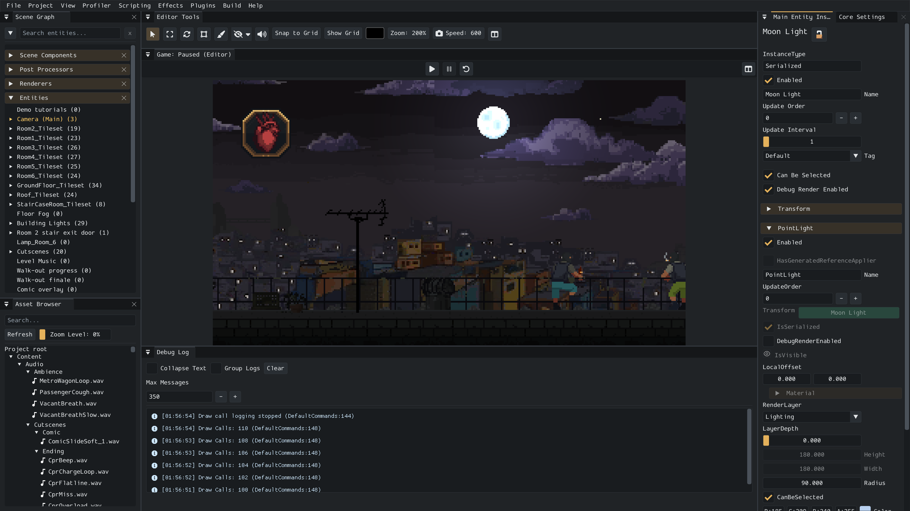
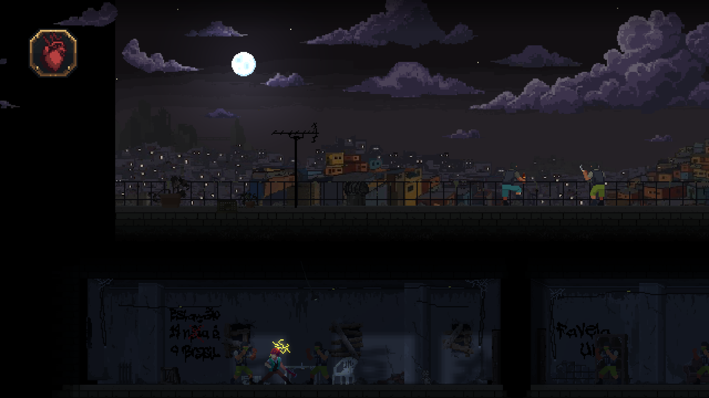

# Voltage Engine

**A C# engine and live editor for 2D pixel art games on Windows, macOS and Linux.**

## [Documentation: voltageengine.github.io/VoltageEngine](https://voltageengine.github.io/VoltageEngine/)

The manual covers the editor, scripting, rendering and lighting, physics, plugins and the Voltage CLI. Its Markdown source lives in [`docs/`](docs/intro.md).



*The editor running Jolt: Scene Graph and Asset Browser on the left, the live Game view in the centre, the Inspector on the right and the Debug Log below.*

## Build and run the editor

1. Install the [.NET 8 SDK](https://dotnet.microsoft.com/download/dotnet/8.0) and make sure your GPU driver supports OpenGL 3.
2. Clone and build:

   ```bash
   git clone https://github.com/VoltageEngine/VoltageEngine.git
   cd VoltageEngine
   dotnet build Voltage.Editor/Voltage.Editor.csproj -c Editor-Debug
   ```

3. Start `Voltage.Editor/bin/Editor-Debug/<platform>/Voltage.Editor`, for example `win-x64/Voltage.Editor.exe` on Windows. Pass a `.voltage` file to open a project directly.

## Use it

1. Choose **File > New Project**, enter a name and a folder, and click **Create Project**. The new project already has a startup scene and an example component.
2. Drag a `.png` or `.aseprite` file from the Asset Browser into the Game view to place it as a sprite.
3. Write components in the project's `Scripts/` folder. Saving a script recompiles it and reloads the scene.
4. Select an entity, choose **Add Component** in the Inspector, and press `Ctrl+S` to save the scene.
5. Press **Play** (`F1`) to run the game in the editor, and **Build > Build Game** to publish it for Windows, macOS or Linux.

[Installation](docs/getting-started/installation.md) has the platform details, and [Your First Game](docs/getting-started/first-game.md) walks through these steps with code.

## Built around pixel art

| Work | Tools |
| --- | --- |
| Lay out a level | Tile painting, layered tilesets, generated collision, Tiled import and a searchable scene hierarchy. |
| Keep art editable | Aseprite layers, tags and frame timing; source-image sync in the Tile Palette and Tileset Editor. |
| Light the scene | Eight deferred light types, animated normal maps and glow painted in Aseprite with Voltage Normals. |
| Author behavior | C# components, saved data assets, prefabs, animation events and timelines. |
| Iterate in context | Play, pause, inspect, undo and hot reload without leaving the editor. |



*Jolt in the game view, with debug overlays hidden. Artwork and lighting shown here belong to the game project.*

The lighting works with the artwork: normal maps follow animated sprite frames, [room lights](docs/graphics/lights/room-light.md) keep interiors readable, and [projected lights](docs/graphics/lights/projected-light.md) use transparent pixels as openings. See the [Lighting Overview](docs/graphics/lighting.md) for every light type.

## One project, desktop platforms

The editor and runtime use SDL2 and OpenGL through MonoGame DesktopGL. Windows, Linux and both Intel and Apple Silicon macOS have desktop build targets. The editor's Build window handles game publishing, asset compilation and NativeAOT settings; NativeAOT builds need the target platform's native toolchain.

Game scripts reference the runtime, independently of the editor. Source-generated serialization preserves component and data-asset bindings without relying on runtime reflection. See [Platforms](docs/getting-started/platforms.md) and [Serialization and NativeAOT](docs/engine/serialization-and-aot.md).

## Voltage CLI and AI collaboration

Voltage exposes the running editor through a local [Editor Gateway, CLI and MCP server](docs/gateway/README.md). Scripts and AI agents can inspect scenes, author entities and component settings, work with saved assets and run checks through the same supported editor operations. Undoable edits remain visible in the editor for you to review and adjust.

The [live Aseprite bridge](docs/editor/aseprite.md) brings sprite work into that workflow: agents can create and edit sprites, layers, pixels, palettes, tags and frames, preview the results and import them into the project. [The tool catalogue](docs/engine/aseprite-tool-catalogue.md) describes the available art operations.

## Documentation and source

| Guide | Reference |
| --- | --- |
| [Editor projects](docs/editor/projects.md) | [Editor windows](docs/editor/windows.md) |
| [Scenes and prefabs](docs/editor/scenes-and-prefabs.md) | [Asset formats](docs/assets/README.md) |
| [Scripting](docs/scripting/components.md) | [Rules and gotchas](docs/scripting/rules-and-gotchas.md) |
| [Lighting](docs/graphics/lighting.md) | [Plugins](docs/plugins/README.md) |

| Project | Role |
| --- | --- |
| `Voltage.Engine` | Scenes, entities, components, rendering, physics, content and audio. |
| `Voltage.Editor` | Editor UI, asset management, hot reload, game publishing and gateway. |
| `Voltage.Cli` | Gateway client and MCP server. |
| `Voltage.SourceGenerators` | Component and data-asset serialization for NativeAOT. |
| `Voltage.Persistence` | Scene, prefab and asset JSON persistence. |
| `docs/` | Markdown manual; `Voltage.github.io/` builds the documentation site. |

To preview the documentation locally, run `npm install` and `npm run start` in `Voltage.github.io/`. `npm run build` checks the site and its links.

See [CONTRIBUTING.md](CONTRIBUTING.md) for contribution guidance. The engine uses the [MIT licence](LICENSE); bundled UI assets have their own [licence](UI_LICENSE).
