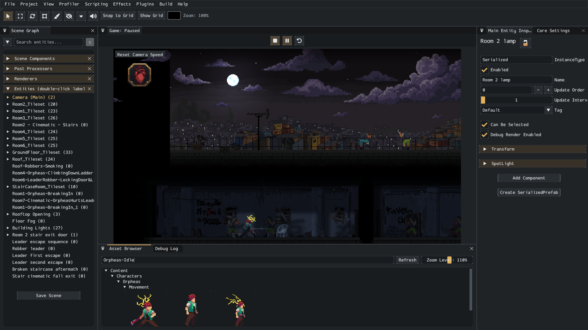

# Voltage Engine

**A C# engine and live editor for 2D pixel art games on Windows, macOS and Linux.**

Build a scene, paint its tiles, adjust the lighting and press Play in the same window. Voltage combines a dockable editor with a MonoGame DesktopGL runtime, keeping game code in your own C# project. Scripts reload on save; finished games can ship as self-contained NativeAOT binaries.



*The editor running Jolt. Scene, asset and script workflows share a live game view.*

[Read the manual](https://voltageengine.github.io/VoltageEngine/) · [Build the editor](docs/getting-started/installation.md) · [Make your first game](docs/getting-started/first-game.md)

## Built around pixel art

| Work | Tools |
| --- | --- |
| Lay out a level | Tile painting, layered tilesets, generated collision, Tiled import and a searchable scene hierarchy. |
| Keep art editable | Aseprite layers, tags and frame timing; source-image sync in the Tile Palette and Tileset Editor. |
| Light the scene | Animated normal maps, point and spot lights, room fills and light projected through transparent board artwork. |
| Author behavior | C# components, saved data assets, prefabs, animation events and timelines. |
| Iterate in context | Play, pause, inspect, undo and hot reload without leaving the editor. |


*Jolt in the game view, with debug overlays hidden. Artwork and lighting shown here belong to the game project.*

The lighting works with the artwork: normal maps can follow animated sprite frames, [room lights](docs/graphics/room-light.md) keep interiors readable, and [projected lights](docs/graphics/projected-light.md) use transparent pixels as openings. The latter is a 2D surface-light projection with configurable depth and softness, not a full 3D or volumetric renderer.

## One project, desktop platforms

The editor and runtime use SDL2 and OpenGL through MonoGame DesktopGL. Windows, Linux and both Intel and Apple Silicon macOS have desktop build targets. The editor's Build window handles game publishing, asset compilation and NativeAOT/trimming settings; publishing needs the target platform's native toolchain.

Game scripts reference the runtime, independently of the editor. Source-generated serialization preserves component and data-asset bindings without relying on runtime reflection. See [installation requirements](docs/getting-started/installation.md) and [serialization and NativeAOT](docs/engine/serialization-and-aot.md).

## Get started

Install the .NET 8 SDK, then build the editor:

```bash
git clone https://github.com/VoltageEngine/VoltageEngine.git
cd VoltageEngine
dotnet build Voltage.Editor/Voltage.Editor.csproj -c Editor-Debug
```

On Windows, launch `Voltage.Editor/bin/Editor-Debug/win-x64/Voltage.Editor.exe`. The output folder matches your platform; [installation](docs/getting-started/installation.md) covers Linux and macOS. Choose **File → New Project**, create a scene and add a `partial Component` under `Scripts/`. Saving the script recompiles it in the editor.

## Automation and AI collaboration

Voltage exposes the running editor through a local [Editor Gateway, CLI and MCP server](docs/gateway/README.md). An AI agent can inspect scenes, author entities and component settings, work with saved assets and run checks through the same supported editor operations. Undoable edits remain visible in the editor for you to review and adjust.

The [live Aseprite bridge](docs/editor/aseprite.md) brings sprite work into that workflow too: agents can create and edit sprites, layers, pixels, palettes, tags and frames, preview the results and import them into the project. It supports agent-assisted sprite creation and iteration; image-generation services remain external tools. [The tool catalogue](docs/engine/aseprite-tool-catalogue.md) describes the available art operations.

## Documentation and source

| Guide | Reference |
| --- | --- |
| [Editor projects](docs/editor/projects.md) | [Editor windows](docs/editor/windows.md) |
| [Scenes and prefabs](docs/editor/scenes-and-prefabs.md) | [Asset formats](docs/assets/README.md) |
| [Scripting](docs/scripting/components.md) | [Rules and gotchas](docs/scripting/rules-and-gotchas.md) |
| [Audio](docs/scripting/audio.md) | [Plugins](docs/plugins/README.md) |

| Project | Role |
| --- | --- |
| `Voltage.Engine` | Scenes, entities, components, rendering, physics, content and audio. |
| `Voltage.Editor` | Editor UI, asset management, hot reload, game publishing and gateway. |
| `Voltage.Cli` | Gateway client and MCP server. |
| `Voltage.SourceGenerators` | Component and data-asset serialization for NativeAOT. |
| `Voltage.Persistence` | Scene, prefab and asset JSON persistence. |
| `docs/` | Markdown manual; `Voltage.github.io/` builds the documentation site. |

To preview documentation, run `npm install` and `npm run start` in `Voltage.github.io/`. `npm run build` checks the site and its links.

See [CONTRIBUTING.md](CONTRIBUTING.md) for contribution guidance. The engine uses the [MIT licence](LICENSE); bundled UI assets have their own [licence](UI_LICENSE).
