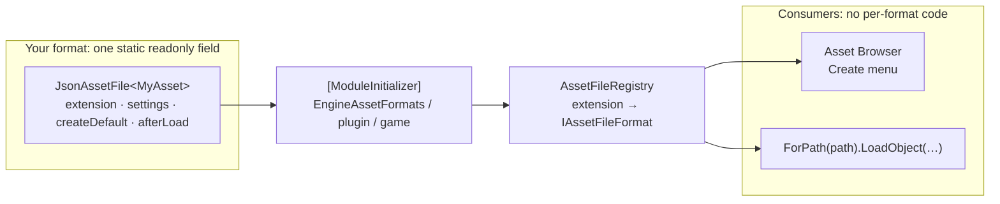

# Asset File Formats

How the engine's own asset file types work and how to add your own, for engine contributors, plugin authors and game developers.

An **asset file format** is a file extension plus the code that turns that file into an object and back. `.vtileset`, `.vtimeline` and `.vasset` are the built-in examples. They share one implementation, `JsonAssetFile<T>`, so adding a format takes a few lines rather than another copy of the same load and save code.

## 1. The landscape

A project contains two kinds of file: **source assets** authored in other tools (`.png`, `.aseprite`, `.ogg`, `.tmx`, `.fx` and so on) and **native assets** the engine defines.

| Extension | Backing type | Owner |
|---|---|---|
| `.voltage` | project metadata | `ProjectManager` |
| `.vscene` | `SceneData` | `Scene.LoadFromFile` |
| `.vprefab` | `PrefabData` | `SerializationManager` |
| `.vtileset` | `TilesetAsset` | `TilesetAssetIO` |
| `.vtimeline` | `TimelineAsset` | `TimelineAssetIO` |
| `.vasset` | a `DataAsset` subclass | `DataAssetIO` (see §6) |

`.vscene` and `.vprefab` are special-cased throughout the engine (entity graphs, prefab deltas, generated scene readers) and do **not** use the pattern below. The other native formats do, and so does anything you add.

### Identity: GUIDs, not paths

Every file the editor indexes gets a stable GUID in a `.meta` file next to it (`AssetDatabase`). References store that GUID, so **renaming or moving an asset never breaks a reference**. A rename or move made outside the editor while it is open (Explorer, git, a script) takes the `.meta` along; one made while the editor is closed needs the `.meta` moved with the file. If two files claim one GUID (a copied `.meta`), the file the manifest last pointed at keeps it and the copy gets a new one, with a warning in the console.

The editor keeps a GUID to path map in `Data/assets.manifest`, rewritten on every asset refresh. It ships in the build's `Data/` folder, and `Voltage.Assets.AssetManifest` reads it at runtime, so published builds resolve references by GUID too.

A new format gets all of this without any identity code of its own.

## 2. The pattern: `JsonAssetFile<T>`

JSON-backed, single-object asset formats differ in only three things:

1. the file extension,
2. the `JsonSettings` used to encode and decode,
3. how a fresh default instance is built,

plus an optional post-load hook. `JsonAssetFile<T>` takes exactly those as constructor arguments and supplies `CreateDefault`, `CreateAndSave`, `ToJson`, `FromJson`, `Save` and `Load`.



`IAssetFileFormat` is the non-generic view of a format (`Extension`, `DisplayName`, `AssetType`, `LoadObject`, `SaveObject`, `CreateOptions`). It lets the editor treat every format uniformly: the Asset Browser's **Create** submenu is a loop over `AssetFileRegistry.All`, not a hard-coded list.

## 3. Adding a format

### 3.1 Define the asset type

A plain class. No base class, interface or attributes required.

```csharp
namespace MyGame.Dialogue
{
    public class DialogueTable
    {
        public string Name;
        public string DefaultSpeaker = "Narrator";
        public List<DialogueLine> Lines = new();
    }

    public class DialogueLine
    {
        public string Key;
        public string Speaker;
        public string Text;
        public float  HoldSeconds = 2f;
    }
}
```

### 3.2 Declare the format and a facade

```csharp
using Voltage.Assets;

namespace MyGame.Dialogue
{
    public static class DialogueTableIO
    {
        public const string FileExtension = ".vdialogue";

        public static readonly JsonAssetFile<DialogueTable> Format = new(
            FileExtension,
            "Dialogue Table",
            createDefault: name => new DialogueTable { Name = name });

        public static DialogueTable Load(string path)               => Format.Load(path);
        public static void          Save(DialogueTable a, string p) => Format.Save(a, p);
        public static DialogueTable CreateAndSave(string path)      => Format.CreateAndSave(path);
    }
}
```

The facade is optional (`DialogueTableIO.Format.Load(path)` works as well), but it keeps call sites short and gives format-specific helpers a home.

`createDefault` receives the file name without its extension as a naming hint, or `null` when the asset is created outside a file context. Use it to seed a `Name` field, or ignore it.

### 3.3 Register it

Register from a `[ModuleInitializer]`, not from a lazy static (see §5.1).

```csharp
using System.Runtime.CompilerServices;
using Voltage.Assets;

namespace MyGame.Dialogue
{
    internal static class DialogueFormats
    {
        [ModuleInitializer]
        internal static void Install() => AssetFileRegistry.Register(DialogueTableIO.Format);
    }
}
```

This works wherever the code lives:

| Where your code lives | Does `[ModuleInitializer]` run? |
|---|---|
| **Engine** (`Voltage.Engine`) | Yes, but add your line to `EngineAssetFormats.RegisterAll()` instead, so the engine formats stay in one place. |
| **Plugin** | Yes. `PluginManager` calls `RunModuleConstructor` on load, and `PluginBootstrap.g.cs` forces it in NativeAOT builds. |
| **Game project** (`Scripts/`) | Yes. `ScriptManager` calls `RunModuleConstructor` after compiling your scripts. |

The format now appears under **Create > Dialogue Table** in the Asset Browser context menu, and `AssetFileRegistry.ForPath("…/Intro.vdialogue")` resolves it.

## 4. Using your asset

### 4.1 From a component

An `AssetReference` field gives you a drag-and-drop slot in the Inspector:

```csharp
public partial class DialoguePlayer : Component
{
    public AssetReference Table;      // drag a .vdialogue from the Asset Browser

    private DialogueTable _table;

    public override void OnStart()
    {
        var path = Table.ResolvePath();          // GUID first; survives rename and move
        _table = DialogueTableIO.Load(path);
    }
}
```

`AssetReference` resolves GUID-first, through the editor's `AssetDatabase` in the editor and through `assets.manifest` in a published build, and falls back to the stored path.

### 4.2 Shipping the file

Keep custom asset files under `Content/` or `Data/`. The generated `.csproj` copies both to the output, and a game build copies them into the build folder; when the build compiles assets, `Content/` follows the project's [Asset Build](../editor/asset-build.md) rules. Scenes and prefabs are the exception: the build packages every `.vscene` it includes and every `.vprefab` from wherever they live in the project. Any other file outside `Content/` and `Data/` works in the editor and is then **missing from the build**.

### 4.3 Loading through `Scene.LoadAsset<T>`

`Core.Scene.LoadAsset<T>(reference)` dispatches on `T` through `VoltageContentManager`. The engine covers textures, sounds, sprite atlases, bitmap fonts, Aseprite files, Tiled maps, tilesets, particle configs, effects, JSON strings and every `DataAsset` subclass. Teach it your type with `VoltageContentManager.RegisterLoader`, from the same module initializer:

```csharp
using Voltage.Systems;

[ModuleInitializer]
internal static void Install()
{
    AssetFileRegistry.Register(DialogueTableIO.Format);
    VoltageContentManager.RegisterLoader<DialogueTable>((content, path) => DialogueTableIO.Load(path));
}
```

A registered loader shares the content manager's `LoadedAssets` cache, and a compiled `.xnb` from an asset build still takes precedence when one exists. After that, `Scene.LoadAsset<DialogueTable>(Table)` works like any built-in type.

## 5. Rules and gotchas

### 5.1 Register from a `[ModuleInitializer]`, never a lazy static

It is tempting to populate `AssetFileRegistry` as a side effect of the first use of `DialogueTableIO`. Do not: the registry would be **empty for any caller that arrives first**, and the symptom is silent, a Create menu with missing entries rather than an exception.

`AssetFileRegistry.EnsureEngineFormatsRegistered()` guards the engine's own formats on every read path as a second line of defence, but it only covers the formats in `EngineAssetFormats`. Your format needs its own module initializer.

### 5.2 Polymorphic members need `TypeNameHandling.Auto`

The default settings are pretty-printed, with **no type names** and no reference tracking, which suits a plain data file. If a member's declared type is abstract or a base class (a `List<Track>` holding `TransformTrack`s), the concrete type is lost on save unless you opt in:

```csharp
settings: new JsonSettings
{
    PrettyPrint = true,
    TypeNameHandling = TypeNameHandling.Auto,
    PreserveReferencesHandling = false,
}
```

This is what `.vtimeline` does. The encoder writes an `@type` hint per polymorphic value.

Two caveats. Type hints are **CLR type names**, so renaming or moving the class breaks existing files. And resolving them uses reflection, which a NativeAOT build can trim. Engine types survive because `TrimmerRoots.xml` preserves `Voltage.dll` wholesale, and prebuilt plugin assemblies are preserved through their trimmer roots; types in your game project may need a `[DynamicDependency]`. Prefer concrete types where you can.

### 5.3 The post-load hook

`afterLoad` runs after a successful decode and is skipped when decoding yields null. Use it for derived state that deserialization cannot rebuild:

```csharp
afterLoad: asset => asset.InvalidateEventOrder()
```

### 5.4 Icons, double-click and drop behaviour

`AssetTypeRegistry` (in `Voltage.Editor`) maps an extension to its Asset Browser icon, its `AssetKind`, an optional drop factory (what dragging the file into the scene creates) and an optional `Open` action (what double-clicking does). A format registered only through `AssetFileRegistry` loads, saves and appears in the Create menu, but shows the generic icon and cannot be dropped into the viewport.

Engine and editor code add descriptors in `AssetTypeRegistry`'s static constructor, with icon PNGs under `DefaultContent/UI/RemixIcon/FileTypes/`. An editor plugin calls `AssetTypeRegistry.Register` from `IEditorPlugin.Initialize`:

```csharp
AssetTypeRegistry.Register(new AssetTypeDescriptor(
    Extensions: new[] { ".vdialogue" },
    IconPath: "DefaultContent/UI/AssetTypes/Data.png",
    Kind: AssetKind.Custom,
    DropFactory: null)
{
    Open = path => _dialogueWindow.Open(path),
});
```

`IconPath` is loaded with `Core.Content.LoadTexture`. A `DropFactory` receives the asset's `AssetReference` and, for a drop on the game view, the world position. Registering again replaces the descriptor for the same extensions.

### 5.5 Saving is not atomic

`Save` is a plain `File.WriteAllText`, so a crash mid-write truncates the file. Scenes and prefabs behave the same way. For a large or precious asset, write to a temporary file and move it into place yourself.

### 5.6 `Load` returns null for a missing file

It does not throw. Callers that need a hard failure must check.

## 6. Data assets (`.vasset`)

A **data asset** is a file of shared, referenceable data with no entity, transform or update cost, like Unity's ScriptableObject: difficulty tables, item definitions, loot tables, dialogue data, tuning curves.

You do **not** write an IO class or a format for one. Declare a class; the source generator does the rest.

### 6.1 Declaring one

```csharp
using System.Collections.Generic;
using Voltage;
using Voltage.Data;
using Voltage.Serialization;

[AssetTypeId("DifficultyProfile")]          // stamped automatically on first compile, then frozen
public partial class DifficultyProfile : DataAsset
{
    public string DisplayName = "Normal";
    public float  EnemyHealthMultiplier = 1f;
    public Tier   Aggression = Tier.Medium;
    public List<LootEntry> Loot = new();
    public AssetReference Portrait;

    public override void OnLoaded() { /* optional: derive caches, migrate old files */ }
}

public class LootEntry : ISerializableData    // nested data needs this marker
{
    public string Item;
    public int Weight = 1;
}
```

A data asset must be **concrete**, **`partial`** and have a **public parameterless constructor**. The generator emits a reflection-free reader into the partial half, which is what lets data assets load under NativeAOT. Script files for one can start from **Create > New Script > Data Asset** in the `Scripts` folder.

Create an asset with right-click **Create > Data Asset > &lt;your type&gt;**, and double-click it to edit. One window serves every type, built from the same inspectors as the entity Inspector: enums, lists, colours, asset slots, nested types and `[Tooltip]` all work with no editor code.

### 6.2 Reading one

```csharp
public partial class Enemy : Component
{
    [AssetType(typeof(DifficultyProfile))]     // the slot only accepts this type
    public AssetReference Difficulty;

    private DifficultyProfile _profile;

    public override void OnStart()
        => _profile = DataAssets.Load<DifficultyProfile>(Difficulty);
}
```

`[AssetType]` makes the Inspector filter its picker and **reject** a mismatched drag. It also accepts an extension list, as in `[AssetType(".png", ".aseprite")]`, for source assets. `DataAssets.LoadFromPath<T>` loads by absolute path, and `Scene.LoadAsset<T>` works for any `DataAsset` subclass.

### 6.3 Sharing, and the one thing to watch

`Load` returns the **same instance** for the same asset. That is the point: edit the file and every consumer sees it. It also means a runtime change is visible everywhere.

- For per-consumer state, mark the type `[CloneOnLoad]` and each `Load` returns a fresh copy.
- In the editor, loaded assets are snapshotted on entering Play mode and restored on exit, so gameplay changes never overwrite your authored values.

### 6.4 Swapping variants

A `DataAssetSet` maps keys to other data assets, so difficulty (or region, or platform tier) is authored rather than coded:

```csharp
[AssetType(typeof(DataAssetSet))]
public AssetReference Stats;

public override void OnStart()
{
    _stats = DataAssets.LoadVariant<EnemyStats>(Stats);   // resolves DataVariant.Active
    DataVariant.Changed += ReloadStats;                   // unsubscribe in OnRemovedFromEntity
}
```

Set `DataVariant.Active = "Hard"` once, from a menu. An unknown key falls back to the set's `DefaultKey` (`"Default"` unless you change it). Adding a "Nightmare" tier is a row in an asset, not a code change. A slot expecting a set also accepts a plain asset, so you can move from one asset to a set of variants without touching the reader.

### 6.5 Versioning and renaming

- Renaming the class or its namespace is safe: files store the `[AssetTypeId]`, not the type name.
- Renaming or moving the **file** is safe: references resolve by GUID.
- Changing fields: unknown keys in a file are skipped and missing ones keep their defaults, so adding and removing fields does not break anything. For a real migration, add `[AssetVersion(2)]` and branch on `LoadedVersion` inside `OnLoaded`.

### 6.6 Limits

- **Polymorphic fields are not supported.** A `List<Ability>` with an abstract element type will not round-trip. Use concrete types.
- **Only public members persist.** A non-public member marked `[Serialize]` is reported as VLT014 rather than silently dropped, because data assets are written by the reflection encoder, which only writes public members.
- Diagnostics: VLT010 duplicate `[AssetTypeId]`, VLT011 no public parameterless constructor, VLT012 not `partial`, VLT013 no serializable members, VLT014 non-public `[Serialize]` member, VLT015 missing `[AssetTypeId]`, VLT003 a struct field with an explicit parameterless constructor.

## 7. Reference

**`Voltage.Assets`** (`Voltage.Engine/Assets/`)

| Type | Purpose |
|---|---|
| `JsonAssetFile<TAsset>` | The shared load and save implementation. One `static readonly` instance per format. |
| `IAssetFileFormat` | Non-generic view: `Extension`, `DisplayName`, `AssetType`, `LoadObject`, `SaveObject`, `CreateOptions`. |
| `AssetCreateOption` | One entry in the Asset Browser's Create menu: label, default file name, writer. |
| `AssetFileRegistry` | Extension to format lookup: `Register`, `ForExtension`, `ForPath`, `IsKnownAssetFile`, `All`. |
| `EngineAssetFormats` | The `[ModuleInitializer]` that installs the built-in formats. Engine formats go here. |
| `AssetManifest` | Runtime GUID to path resolution from `Data/assets.manifest`. |

**`Voltage.Systems`**

| Type | Purpose |
|---|---|
| `VoltageContentManager.RegisterLoader<T>` | Adds a loader for a custom type to `Scene.LoadAsset<T>` and `AssetReference` loading. |

**`Voltage.Data`** (`Voltage.Engine/Data/`)

| Type | Purpose |
|---|---|
| `DataAsset` | Base class for a `.vasset`: `SourceGuid`, `SourcePath`, `LoadedVersion`, `OnLoaded()`. |
| `[AssetTypeId]` | Stable, rename-proof type id. Stamped automatically, then frozen. |
| `[CloneOnLoad]`, `[AssetVersion]` | Opt out of instance sharing; declare a schema version. |
| `ISerializableData` | Marks a nested class as serializable (`IComponentGroup` derives from it). |
| `DataAssets` | `Load<T>`, `LoadVariant<T>`, `LoadFromPath<T>`. |
| `DataAssetIO` | Load and save, and `PeekAssetTypeId` (reads only the header). |
| `DataAssetCache` | The shared-instance store: in-place reload and the Play-mode snapshot. |
| `DataAssetRegistry` | Id to type, factory and reader, filled by generated module initializers. |
| `DataAssetSet`, `DataVariant` | Key to asset mapping, and the globally active key. |
| `[AssetType]` | In `Voltage.Serialization`. Constrains an `AssetReference` Inspector slot. |

**Several create options.** `CreateOptions` defaults to a single "New &lt;DisplayName&gt;" entry. A format whose files come in several flavours can implement `IAssetFileFormat` directly and return one option per flavour; the Asset Browser shows them as a submenu.

## See also

- [Plugins](../plugins/README.md): shipping a format, and its editor tooling, as a plugin.
- [Content Loading](../scripting/content-loading.md): the content manager layer for source assets (textures, audio, effects).
