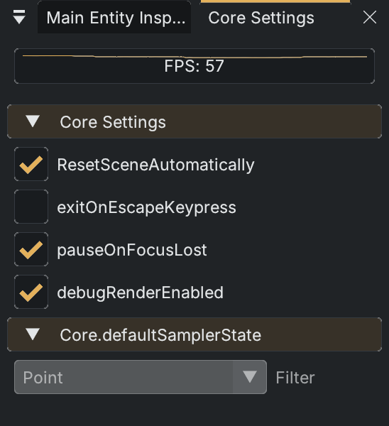

# Core Settings

Open **View > Window > Core Window**. The window title is **Core Settings**; older references may call this the Core Selector. It shows a recent FPS graph and live engine switches.

| Current label | Engine setting |
|---|---|
| `ResetSceneAutomatically` | Restores the scene when returning from Play to Edit, discarding unsaved runtime changes. |
| `exitOnEscapeKeypress` | Controls the engine's Escape-to-exit behavior. |
| `pauseOnFocusLost` | Controls pausing when the application loses focus. |
| `debugRenderEnabled` | Enables engine debug rendering. |

These controls write live Core settings directly. They are not a replacement for project configuration or the category preferences in the [Editor Tools debug dropdown](windows.md). The **Core.defaultSamplerState > Filter** field is currently disabled and cannot be edited here.
