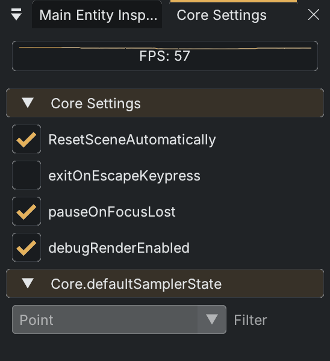

# Core Settings

Open **View > Window > Core Window**; the window's title is **Core Settings**. It shows an FPS graph of the last 100 frames (scaled 0 to 60) and checkboxes bound directly to static fields on `Core`.

| Label | Field | Default in the editor | Effect |
|---|---|---|---|
| `ResetSceneAutomatically` | `Core.ResetSceneAutomatically` | On | Reloads the scene from its file when Play stops, discarding changes made during Play. Turn it off to keep the played state after stopping. |
| `exitOnEscapeKeypress` | `Core.ExitOnEscapeKeypress` | Off | Quits the application on `Esc` or gamepad Back. The engine default is on; the editor turns it off at startup. Turning it on here makes `Esc` close the editor. |
| `pauseOnFocusLost` | `Core.PauseOnFocusLost` | On | Stops updating and drawing while the window is unfocused. The editor keeps running anyway during Play, while a build, compile or load shows progress, and while the gateway drives it. |
| `debugRenderEnabled` | `Core.DebugRenderEnabled` | On | Master switch for debug rendering. The eye button in Editor Tools and the Play-mode debug setting in File > Settings also set it. |

The values are not saved: every editor launch starts from the defaults above. To change which debug categories draw, use the [Editor Tools debug dropdown](windows.md#editor-tools). Project-wide settings belong in [Project Settings](projects.md#project-settings).

The **Core.defaultSamplerState > Filter** field is shown greyed out and cannot be edited here.
