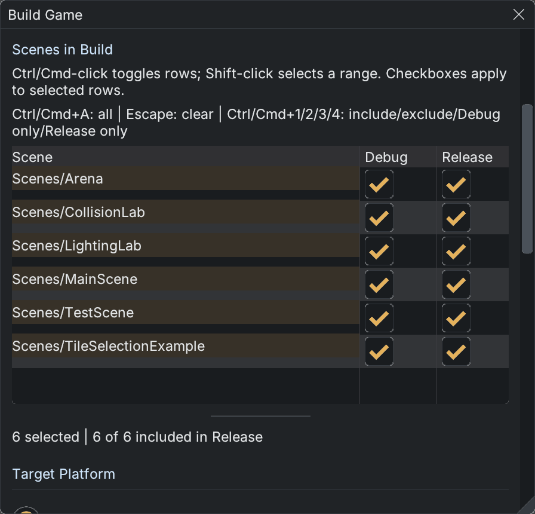

# Build Game and Scene Presets

**Build > Build Game** publishes a standalone, self-contained game: the executable with the compiled scripts, the engine's content, the project's `Content` folder, scenes, prefabs, data and `ProjectSettings.json`. This is separate from [asset compilation](asset-build.md), which **Compile assets on build** can run as part of the build.

## Build options

| Option | Effect |
|---|---|
| Scene to load on startup | The scene the game opens first. It is saved to `ProjectSettings.json` and must be included in the configuration being built. |
| Scenes in Build | Which scenes ship in Debug and in Release; see [Scenes in Build](#scenes-in-build). |
| Target Platform | Windows (x64), Linux (x64), macOS (x64) or macOS (ARM64 / Apple Silicon). Nintendo Switch, PlayStation 4/5 and Xbox (GDK) are listed but not available yet. |
| Debug Build | Off (default) publishes Release with full optimisation. On publishes Debug with full symbols. |
| Native AOT | On (default) compiles a trimmed native executable, the build you ship. Off makes a plain self-contained build that is faster to produce and needs no C++ build tools. |
| Build in glibc-compat container | Linux targets only; see [Linux builds](#linux-builds). |
| Compile assets on build | Compiles textures, Aseprite files and fonts with MGCB first; configure it under **Build > Asset Build**. Off copies `Content` as-is. |

The output goes to `bin/<Debug|Release>/<platform>` inside the project, shown as **Output** at the top of the window.

**Build** publishes; **Build and Run** publishes and then starts the game. A Debug game opens with its own console window; a Release game's output goes to the editor log. **Build > Build and Run** (Ctrl+F5) repeats the last options without opening the window. Progress shows in a progress window whose **Cancel** stops the build. The window's own **Cancel** only closes it.

Native AOT needs native tools: MSVC and the Windows SDK on Windows, clang, ld and zlib on Linux, and the Xcode tools on macOS. **Check Dependencies** reports what is missing and how to install it. Before each build the same check runs; if something seems to be missing it offers **Build anyway**, because detection is best-effort and the build itself is the real test. You can turn that prompt off.

A `.vasset` data asset outside `Content/` and `Data/` is not shipped, and the build log warns about each one.

## Linux builds

A Native AOT binary is linked against the glibc of the machine that builds it, and will not start on a system with an older glibc. With **Build in glibc-compat container** on (the default), a Linux build made on Linux or macOS runs the publish inside an Ubuntu 20.04 container through podman or docker, so the game needs only glibc 2.31 and runs on SteamOS and older distributions. When the editor itself runs in a distrobox, the host's podman is used. The first build prepares the container image and can take several minutes.

If no container runtime is found, the build falls back to a direct publish and logs a warning that the binary may only run on systems with the build machine's glibc or newer.

## macOS app

A macOS build produces `bin/<Configuration>/<rid>/<Project>.app`. The executable is in `Contents/MacOS`, MonoGame's SDL2 and OpenAL libraries are in `Contents/Frameworks`, and the content, data, scenes and `ProjectSettings.json` are in `Contents/Resources`. When the game starts from the bundle, the engine points `AppContext.BaseDirectory` at `Contents/Resources`, so code that reads files relative to it needs no changes. Debug symbols (`.dSYM`, and `.pdb` from Native AOT builds) stay next to the app instead of inside it.

`Info.plist` takes its name, version and executable name from the project and requires macOS 12 or later. The bundle identifier is `com.<company>.<project>`, built from `AssemblyCompany` in `Properties/AssemblyInfo.cs`, and `AssemblyCopyright` becomes the copyright line. The icon is converted from the project's `Icon.ico`, or `Icon.bmp` when there is no `.ico`.

The app is signed with the identity in the engine's `Voltage.Editor/mac-signing-identity.txt`, the same file the editor's own app uses (see [Installation](../getting-started/installation.md)). Without that file, or if signing with it fails, the app is signed ad hoc. Either signature runs on the Mac that built it. A copy downloaded on another Mac is blocked by Gatekeeper unless it is signed with a Developer ID and notarized, which Build Game does not do. Icons and signing need macOS, so a macOS build made on Windows or Linux has no icon and no signature.

## Scenes in Build

*Six example scenes are selected. Changing a selected row's checkbox applies to the entire set; the handle below the table changes its height.*

The list shows every `.vscene` anywhere in the project. Names are project-relative, so `Levels/Intro` and `Tests/Intro` stay distinct; `Scenes/` is only the default folder for new scenes. Each row has **Debug** and **Release** checkboxes saying whether the scene ships in that configuration. Scenes without a rule ship in both. The rules are saved in `ProjectSettings.json` as project settings, not scene edits, so they are not part of undo. The line under the table counts the selected scenes and how many are included in the current configuration.

| Control | Result |
|---|---|
| Click a scene name | Select that scene. |
| Ctrl-click (Windows, Linux) or Cmd-click (macOS) | Add or remove one scene from the selection. |
| Shift-click | Select a range from the anchor row, in either direction. |
| Ctrl/Cmd+A | Select every scene, including rows scrolled out of view. |
| Escape | Clear the selection. |
| Click Debug or Release on a selected row | Apply that checkbox's new value to every selected scene. |
| Click a checkbox on an unselected row | Select that row alone and change it. |

With Build Game focused and no text field active, these shortcuts apply to the selected scenes:

| Shortcut | Preset |
|---|---|
| Ctrl/Cmd+1 | Include in Debug and Release. |
| Ctrl/Cmd+2 | Exclude from Debug and Release. |
| Ctrl/Cmd+3 | Debug only. |
| Ctrl/Cmd+4 | Release only. |

For example, Ctrl/Cmd-click three test scenes and press Ctrl/Cmd+3 to keep them out of Release builds. Ctrl/Cmd+A then Ctrl/Cmd+1 puts every scene back in both. Changing only the Debug checkbox leaves each selected scene's Release value as it was.

The table shows at least six rows below its header, which stays in place while you scroll. Drag the short bar under the table to make it taller or shorter. Its height is counted in rows, so changing the interface scale or font does not leave it oversized. Scene rules cannot be changed while a build is running.

Related: [Projects and Folder Layout](projects.md), [Scenes and Prefabs](scenes-and-prefabs.md), [Asset Build Pipeline](asset-build.md).
