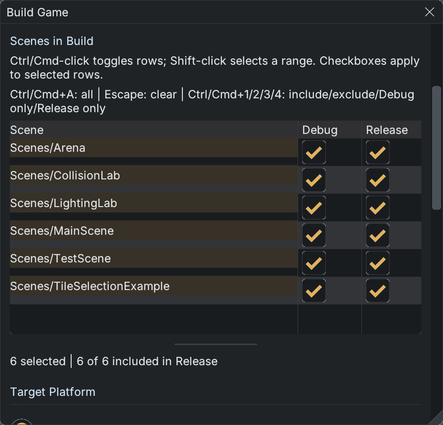

# Build Game and Scene Presets

Open **Build > Build Game** to publish a standalone game. This is separate from [asset compilation](asset-build.md): Build Game publishes the game executable and packages project content.

Choose a target platform, Debug or Release configuration, output options and **Scene to load on startup**, then press **Build** or **Build and Run**. Targets depend on installed native toolchains; unavailable platforms explain their requirements. The progress area reports build results. Cancel stops a running build; opening the panel or selecting scenes does not start one.

## Scenes in Build

*Six example scenes are selected. Changing a selected row's checkbox applies to the entire set; the handle below the table changes its height.*

The list discovers `.vscene` files anywhere inside the project. Names are project-relative scene keys, so `Levels/Intro` and `Tests/Intro` remain distinct. `Scenes/` is only a default creation folder. The startup scene must be included in the configuration being built.

Each row has **Debug** and **Release** checkboxes. A checked box includes the scene in that configuration. Presets are saved in `ProjectSettings.json`; they are project settings, rather than undoable scene-cell edits. Rows without an override are included in both configurations.

| Control | Result |
|---|---|
| Click a scene name | Select that scene. |
| Ctrl-click (Windows/Linux) or Cmd-click (macOS) | Toggle one scene in the selected set. |
| Shift-click | Select a contiguous range from the anchor row, in either direction. |
| Ctrl/Cmd+A | Select every scene, including rows outside the visible area. |
| Escape | Clear the selection. |
| Click Debug or Release on a selected row | Apply that checkbox's new value to all selected scenes. |
| Click a checkbox on an unselected row | Select and edit that row alone. |

With Build Game focused and no text field being edited, these shortcuts apply to selected scenes:

| Shortcut | Preset |
|---|---|
| Ctrl/Cmd+1 | Include in Debug and Release. |
| Ctrl/Cmd+2 | Exclude from Debug and Release. |
| Ctrl/Cmd+3 | Debug only. |
| Ctrl/Cmd+4 | Release only. |

For example, Ctrl/Cmd-click three test scenes and press Ctrl/Cmd+3 to keep them in Debug builds. Ctrl/Cmd+A followed by Ctrl/Cmd+1 restores every scene to both presets. Changing only a Debug checkbox preserves each selected scene's Release value.

The list shows at least six scene rows plus its header. Drag the short horizontal handle immediately below the table to increase or decrease its height within the panel. Scroll for additional scenes; the header stays visible. Capacity follows interface/font scale, so a font change does not permanently enlarge the table. Preset edits are disabled during an active build.

Related: [Projects and Folder Layout](projects.md), [Scenes and Prefabs](scenes-and-prefabs.md), [Asset Build Pipeline](asset-build.md).
