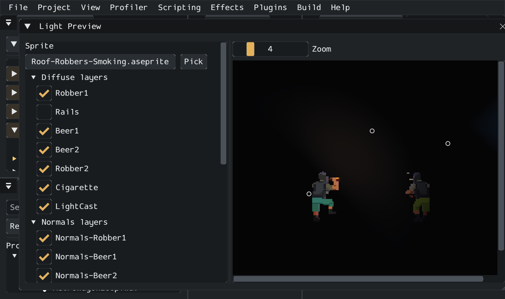

# Light Preview

**View > Window > Light Preview** renders an Aseprite sprite through the real `DeferredLightingRenderer` in a private scene. Nothing is added to the open scene, nothing marks it dirty and nothing goes into the undo history, so it works in Edit and Play mode alike.



Drop an `.aseprite` from the Asset Browser on the file button, or press **Pick**. The window selects the visible art layers, every `Normals-` layer except `-gen` takes, and every `Glow-` layer. Change any of them with the checkboxes. A `Glow-<layer>` is only used while its `Normals-<layer>` is selected. Pick a tag and frame, or press **Play** to run the tag at its Aseprite timing. The file reloads by itself when it changes on disk, so saving in Aseprite updates the view.

Choose a light type and press **Add**. The list holds every non-abstract `DeferredLight` from the engine and the loaded game scripts. Select a light to edit it with the normal inspector widgets, or drag its ring on the view. Positions are pixels from the sprite's centre. `RoomLight`, `ProjectedLight` and `SpriteLight` need their own setup in the inspector before they emit anything: room vertices, a room area or a mask.

**Ambient** and **Background** set the renderer's ambient and clear colours. Lights fall on the background as they do on any unlit clear colour in a scene.

## Custom lights

A game class deriving `DeferredLight` renders in the game and appears in this window with no engine change. Override `RenderCustom`, draw into the light buffer and return `true`:

```csharp
using Microsoft.Xna.Framework;
using Voltage.DeferredLighting;

[LightPreview("Neon strip")]
public partial class NeonStripLight : DeferredLight
{
    public float Spacing = 12;

    public override bool RenderCustom(DeferredLightContext context)
    {
        for (int i = -2; i <= 2; i++)
            context.DrawPoint(Entity.Position + new Vector2(i * Spacing, 0), 24, 90, 1.2f, Color);
        return true;
    }
}
```

`RenderCustom` runs before the built-in types and with additive blending on the light buffer. `DrawPoint` draws one lobe with the point-light shader. For anything else, `DeferredLightContext` gives you `Effect`, `Batcher`, `Camera`, `NormalMap` and the `DrawCircleVolume`, `DrawQuadVolume` and `DrawFullscreen` meshes. Blend, depth and rasterizer states are restored afterwards; the render target is not, so leave it as you found it.

A custom light is treated as visible everywhere. Override `Bounds` to cull it. `[LightPreview("Name")]` sets its name in the list and `[LightPreview(Hidden = true)]` removes it.

## Game materials

A game can offer its own lit material. Mark a static method with `[LightPreviewMaterial("Name")]`; it then appears in the **Material** list:

```csharp
[LightPreviewMaterial("Jolt rim")]
private static DeferredAnimatedMaterial PreviewMaterial(SpriteAnimator animator, IReadOnlyDictionary<string, SpriteAnimation> normals) =>
    Material(animator, normals, new RimLightSettings());
```

The editor finds these by reflection; a published game never calls them.

## Gateway

```text
voltage lighting.list_light_types
voltage lighting.preview_sprite path=Content/Actor.aseprite tag=Idle frame=2 ambient=#202028 lights=[{"type":"PointLight","x":-20,"y":-30,"fields":{"Radius":120,"Intensity":2}}]
voltage lighting.show path=Content/Actor.aseprite
```

`lighting.preview_sprite` renders offscreen and returns the PNG in `image`, which MCP clients receive as image content. `layers`, `normal_layers` and `glow_layers` override the layer picks, `material` selects a preview material, and each light's `fields` are set by member name. The path must be inside the project. `lighting.show` opens the window with the same setup.
