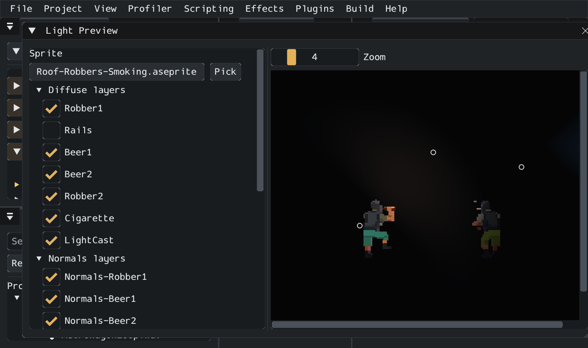

# Light Preview

**View > Window > Light Preview** renders an Aseprite sprite through the real `DeferredLightingRenderer` in a private scene. Nothing is added to the open scene, nothing marks it dirty and nothing enters the undo history, so it works the same in Edit and Play mode and does not depend on the project's deferred lighting setting.



## Load a sprite

Drop an `.aseprite` from the Asset Browser onto the file button, or press **Pick**. The window then ticks:

- **Diffuse layers**: every visible art layer.
- **Normals layers**: every layer named `Normals` or `Normals-<layer>`, except generated `-gen` takes.
- **Glow layers**: every `Glow-<layer>`. A Glow layer only shows while its `Normals-<layer>` is ticked.

Change any of them with the checkboxes; at least one diffuse layer must stay ticked. Choose **All frames** or a tag, then a frame with the slider, or press **Play** to run it at its Aseprite frame timing. **Zoom** scales the view from 1x to 16x.

The window checks the file twice a second and reloads it when it changes on disk, so saving in Aseprite updates the view and keeps the current frame.

## Lights

Choose a light type and press **Add**. The list holds every non-abstract `DeferredLight` in the engine and the loaded game scripts, sorted by name. A new light starts above the sprite. Select a light to edit it with the usual inspector widgets, set **Position**, or drag its ring on the view; positions are pixels from the sprite's centre. **Remove** deletes it.

`RoomLight` lights its default rectangle straight away. `ProjectedLight` and `SpriteLight` read other components (a board tilemap, a source sprite renderer), so they emit nothing until those are assigned; check them in the scene instead.

**Ambient** and **Background** set the renderer's ambient and clear colours. Lights fall on the background the same way they fall on an unlit clear colour in a scene.

After a script recompile, lights from game code are recreated from the new types at the same positions, with default field values.

## Custom lights

A game class deriving from `DeferredLight` renders in the game and appears in this window with no engine change. Override `RenderCustom`, draw into the light buffer and return `true`:

```csharp
using Microsoft.Xna.Framework;
using Voltage.DeferredLighting;

[LightPreview("Neon strip")]
public partial class NeonStripLight : DeferredLight
{
    public float Spacing = 12;

    public override bool RenderCustom(DeferredLightContext context)
    {
        for (int i = -2; i <= 2; i++)
            context.DrawPoint(Entity.Position + new Vector2(i * Spacing, 0), 24, 90, 1.2f, Color);
        return true;
    }
}
```

`RenderCustom` is called before the built-in light types and draws with additive blending into the light buffer. Returning `false` leaves the light to the built-in rendering. `DrawPoint(position, z, radius, intensity, color)` draws one lobe with the point-light shader. For anything else, `DeferredLightContext` provides `Effect`, `Batcher`, `Camera`, `NormalMap` (normals in RGB, self-illumination in alpha) and the `DrawCircleVolume`, `DrawQuadVolume` and `DrawFullscreen` meshes. Blend, depth and rasterizer states are restored afterwards; the render target is not, so leave it as you found it.

A custom light counts as visible wherever the camera looks. Override `Bounds` to cull it. `[LightPreview("Name")]` sets its name in the list and `[LightPreview(Hidden = true)]` leaves it out. In a scene, a custom light still needs the **Lighting** render layer and deferred lighting turned on in **Project > Settings > Rendering Layers**.

## Game materials

A game can offer its own lit material in the **Material** list. Mark a static method with `[LightPreviewMaterial("Name")]`; it must take the animator and the normal animations and return a `DeferredAnimatedMaterial`:

```csharp
[LightPreviewMaterial("Rim lit")]
private static DeferredAnimatedMaterial PreviewMaterial(SpriteAnimator animator, IReadOnlyDictionary<string, SpriteAnimation> normals) =>
    new RimLitMaterial(animator, normals);
```

Here `RimLitMaterial` stands for the game's own subclass of `DeferredAnimatedMaterial`. A method with the wrong signature is skipped with a warning in the log. The editor finds these methods by reflection in the engine and the current scripts; a published game never calls them. **Default** uses the plain deferred material.

## Gateway

```text
voltage lighting.list_light_types
voltage lighting.preview_sprite path=Content/Actor.aseprite tag=Idle frame=2 ambient=#202028 lights=[{"type":"PointLight","x":-20,"y":-30,"fields":{"Radius":120,"Intensity":2}}]
voltage lighting.show path=Content/Actor.aseprite
```

`lighting.list_light_types` returns the light types and preview materials. `lighting.preview_sprite` renders offscreen and returns the PNG in `image`, which MCP clients receive as image content. `layers`, `normal_layers` and `glow_layers` replace the default layer picks, `tag` and `frame` choose the frame, `ambient` and `background` take `#RRGGBB`, `material` selects a preview material, and each light's `fields` are set by member name. The path must be an `.aseprite` or `.ase` inside the project. `lighting.show` opens the window with the same setup, replacing its current lights.
