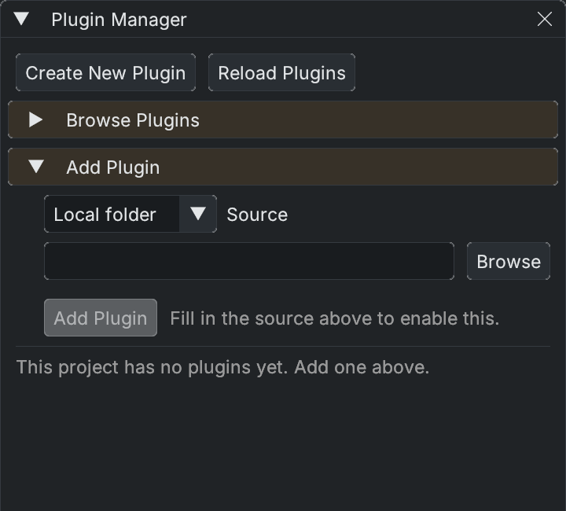

# Plugin Manager

Open **Plugins > Plugin Manager** with a project open. The window manages that project's plugins. Plugins can also add their own windows and menu items to any editor menu. For manifests, packaging and the editor extension API, see the [plugin development guide](../plugins/README.md).

The **Plugins** menu reads **Plugins (!)** when a plugin is unavailable or failed to load. **Plugins > Restore Plugins (N)** fetches plugins the project declares but this machine does not have yet, for example after pulling a branch that changed the plugin set; it is disabled when nothing is missing.

## Adding plugins

- **Browse Plugins** searches the registry. **Refresh** reloads the catalogue, and install and update buttons name the version they will fetch. If the registry cannot be reached, the last cached list is shown.
- **Add Plugin** takes a **Source**:
  - **Local folder**. A folder containing a project that can package the plugin is treated as a source checkout: it is used in place, rebuilt from source when the editor is built and again when the project opens, and never pinned. A folder without one is treated as a finished package: the editor snapshots it into the plugin cache and pins it, and later edits to the folder need **Update**.
  - **Git URL** with a **Ref** (tag, branch or commit). The ref is pinned to a commit SHA in `plugins.lock.json`. Private repositories use your local git credentials.
  - **Zip URL**.
- **Create New Plugin** scaffolds a plugin folder with `plugin.json` and starter code. Enter a name, a permanent reverse-domain **Id** (for example `com.you.myplugin`; saved scenes rely on it, so do not change it later), description, author and version, tick **Gameplay** and/or **Editor tools**, and choose a location. **Add to this project now** adds it as a live-edit plugin; editor plugins must be built first and then added by hand, as the generated README explains.

Only one install runs at a time. Progress and errors appear at the top of the window, and a running install can be cancelled.

## Installed plugins

Each row shows the plugin's name and id, description, version (with the newer registry version, if any), source, status and actions.

| Status | Meaning |
|---|---|
| **Loaded** | Restored, and its assemblies are loaded in the editor. |
| **Restored** | Fetched, verified and synced into the project. |
| **Disabled** | Declared but switched off; not synced or loaded. |
| **Unavailable** | Could not be fetched or verified (missing source, no repository access, SDK not configured). The project still opens. |
| **Failed** | Restored, but loading or initializing its assemblies failed. |

Actions: **Enable** / **Disable**; **Update** (or **Update to &lt;version&gt;** when the registry lists a newer release), which re-resolves the source and re-pins `plugins.lock.json`; and **Remove**, after a confirmation.

A **LOCAL** tag means this machine resolves the plugin from your own folder while the project declares a source teammates can fetch. **LOCAL ONLY** means nothing in `plugins.json` names the plugin, so teammates cannot restore it; local folder paths are kept in the git-ignored `plugins.local.json`. To share a LOCAL ONLY plugin, publish and declare it, or press **Vendor** to copy it into the repository at `Plugins/<id>/` and declare it from there.

**External SDKs** lists SDKs that plugins need but cannot redistribute. Point each one at your local install with **Browse** and **Save Path**; these paths are per user and never committed.

## Reloading

**Reload Plugins** restarts the editor on the same project, because .NET cannot unload an assembly from a running process. It asks for confirmation, and to save the scene first if it has unsaved changes. A rebuilt plugin is not active until this restart. The button is highlighted when a plugin is still running code from an earlier load.

## Publishing

For plugins you author, **Publish Readiness** runs a read-only check (your git state plus one anonymous GitHub request). **Publish New Version** bumps the version in `plugin.json`, commits, tags and optionally pushes the branch and tag, showing every command before it runs. Afterwards, **Declare for the team** writes the plugin into `plugins.json` as the pushed git URL and tag, so teammates restore that release. Publishing is separate from installing or updating.
