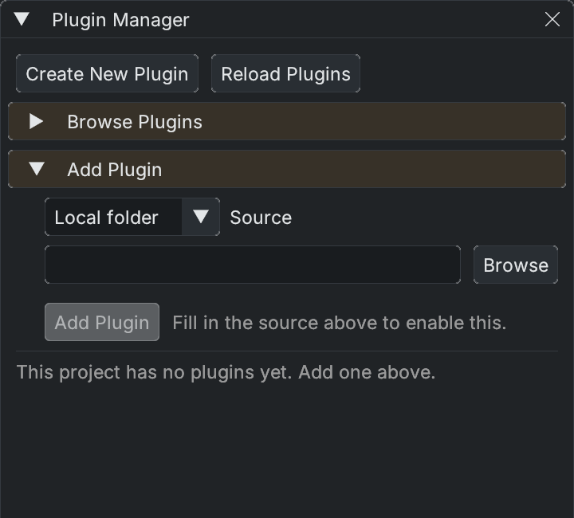

# Plugin Manager

Open **Plugins > Plugin Manager** with a project open. This window manages that project's plugins; individual plugins can also contribute their own windows or menu items. See the [plugin development guide](../plugins/README.md) for manifests, packaging and editor extensions.

- **Browse Plugins** searches the registry. **Refresh** updates the catalogue; install/update controls show the version being requested. If the registry is unavailable, a cached list may still be shown.
- **Add Plugin** accepts a **Local folder**, **Git URL** with a ref, or **Zip URL**. A local source checkout runs from your folder and is rebuilt from source; a built package is copied into the plugin cache and pinned.
- **Create New Plugin** scaffolds a manifest and starter code. Choose gameplay/editor code and a destination, and optionally add it to the current project.
- Installed rows show source, version and status, with applicable **Enable/Disable**, **Update** and **Remove** actions. Check the status messages for installation progress and failures.

**LOCAL** means the editor resolves the plugin from a local folder. **LOCAL ONLY** means teammates cannot restore it from the project's declaration; publish/declare it or vendor it into the repository before sharing the project. The manager also reports missing external SDK paths for plugins that require them.

**Reload Plugins** restarts the editor on the same project because loaded assemblies cannot be replaced in the running process. The editor requests confirmation and saving scene changes when necessary. A rebuilt plugin is not active merely because its source compiled.

Publishing is a separate action from installing or updating. Review the publish plan, version and source-control operations before using the publishing controls.
