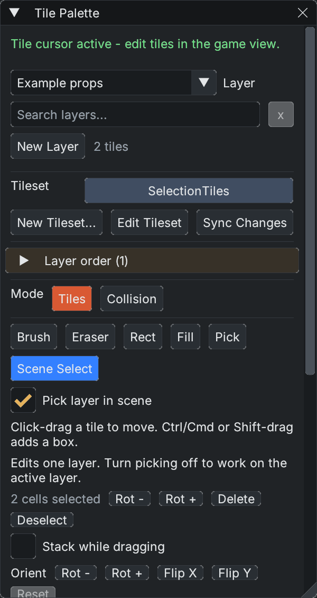
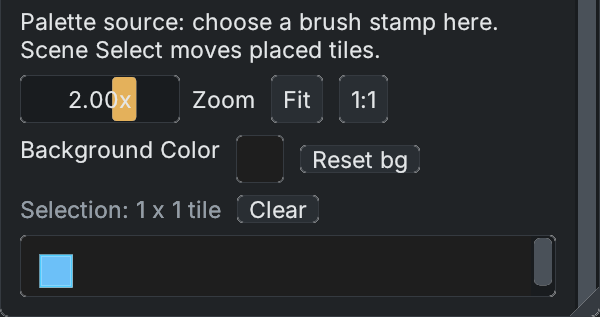

# Tile Palette

Open **View > Window > Tile Palette**. The palette ties together a [tileset](tilesets.md), the scene layer you paint on and the tile tool used in the game view. Picking tiles in its source atlas builds a brush stamp; **Scene Select** works on tiles already placed in the scene.

*The active layer and scene tool are separate from the source atlas below. Tool and action buttons wrap when the window is narrow.*

Painting needs the tile cursor, which works in Edit mode. Choosing a tool turns it on; otherwise press **Activate (B)** or the B (or 5) hotkey. The banner at the top says whether it is active.

## Paint a layer

1. Choose a **Layer**, or type in **Search layers** to find one by name. To make a new one, press **New Layer**, which creates an entity with a `TilemapRenderer` for the current tileset. Dropping a `.vtileset` from the Asset Browser into the game view also creates a layer.
2. Under **Tileset**, assign the tileset. **New Tileset** and **Edit Tileset** open the [Tileset Editor](tilesets.md), and **Sync Changes** rereads edited source art.
3. Pick tiles in the source atlas: click one, or drag a rectangle. Ctrl/Cmd adds another box, Ctrl/Cmd-clicking a picked cell removes its box, and Shift grows the last box. Gaps between boxes stay holes in the stamp. **Clear** drops the pick. Middle-drag pans the atlas and Ctrl+wheel zooms it.
4. Choose **Brush** and click or drag in the game view.
5. Save the scene to keep the painted cells. Tileset changes are saved separately, in the Tileset Editor.

With an empty scene, assign a tileset and start painting: the first stroke creates a layer for it.

| Tool | Use |
|---|---|
| Brush | Stamp the picked tiles. Shift or right-drag erases. |
| Eraser | Clear cells under the stamp's footprint. |
| Rect | Drag a rectangle; the stamp repeats across it. Shift or right-drag erases. |
| Fill | Flood-fill the connected area matching the clicked tile, within the painted area plus a margin. |
| Pick | Copy a placed tile into the brush and switch back to Brush. |
| Scene Select | Select and move placed cells; see [Selecting and Moving Scene Tiles](tile-selection.md). |

A click always places the stamp at the hovered cell. With **Stack while dragging** off (the default), a drag steps by the stamp's own size, laying stamps edge to edge and replacing what is there. With it on, a drag follows the cursor cell by cell: tiles with transparency stack on top of existing tiles, while opaque tiles replace them. Fully transparent tiles in a stamp are always skipped.

**Rot -**, **Rot +**, **Flip X**, **Flip Y** and **Reset** under **Orient** set the brush orientation, and the preview shows the stamp as it will be painted. While the palette has focus, Q and E rotate and Z and X flip; with a Scene Select selection, Q and E rotate the selection instead. These keys can be rebound in the hotkey settings under Tile Palette.

Turn on **Autotile** and choose a terrain to paint terrain instead of fixed tiles: each cell takes the edge or corner tile that fits its neighbours, using the terrain masks set in the Tileset Editor.

*Picking in the source atlas makes a 1×1 brush stamp. It does not select or move tiles already painted in the scene.*

## Collision mode

**Mode** switches between **Tiles** and **Collision**. Collision mode paints the active layer's collision mask instead of its art: Brush, Rect and Fill mark cells solid, and Shift or right-drag clears them. The panel shows how many solid cells there are and how many colliders they merge into.

| Control | Effect |
|---|---|
| Physics layer | The layer the generated colliders belong to |
| Collides with | The layers they collide with |
| Is trigger | Colliders report overlaps but do not block |
| Build colliders on start | Build the colliders when the scene starts, and after moves in Scene Select |
| Solid from all tiles | Mark every painted cell solid |
| Solid from flagged tiles | Mark only cells whose tile is flagged Solid in the tileset |
| Rebuild colliders | Regenerate the colliders from the mask now |
| Clear collision | Empty the mask |

Physics layers come from **Project > Settings > Physics Layers**. Scene Select works in either mode and moves tiles, orientation and collision together.

## Layers

The **Layer** selector decides where painting goes. Changing it clears any Scene Select selection, so a selection from one layer can never edit another.

**Layer order** lists every tilemap layer in the scene, front to back. Each row has its order number, name, a visibility toggle, a per-layer debug render toggle, its render layer and its depth. Click rows to pick them (Ctrl/Cmd toggles, Shift picks a range), then drag them to a new place, or right-click and use **Move to order**. Picked layers move as one block and each reorder is a single undo step. A lower render layer draws in front, the same as for sprites; layers sharing a render layer are ordered by depth, which reordering sets for you. **Debug Render** toggles collider outlines and gizmos for all tilemap layers at once.

## Grid

The grid follows the active layer's transform and tile size. The **Grid** eye shows or hides it, and **Always** keeps it visible when the tile cursor is off. **Grid color**, **Grid thickness** and **Cursor thickness** style the overlays; thicknesses are in screen pixels, so they stay constant as you zoom.

Related: [Tilesets](tilesets.md), [Selecting and Moving Scene Tiles](tile-selection.md), [Main Windows](windows.md), [Scenes and Prefabs](scenes-and-prefabs.md), [Tilemaps in code](../scripting/tilemaps.md).
