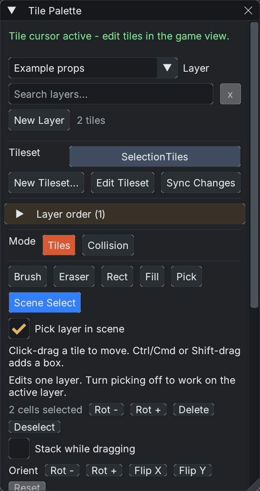
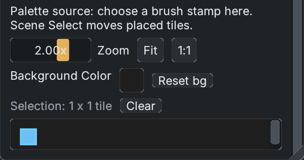

# Tile Palette

Open **View > Window > Tile Palette**. This window connects a [tileset](tilesets.md), a scene tilemap layer and the active viewport tool. Source selection in the atlas creates a brush stamp; **Scene Select** selects tiles already drawn in the scene. Choosing any tool button activates the tile cursor in Edit mode.

*The active layer and scene tool are separate from the source atlas below. Tool and action buttons wrap when the window is narrow.*

## Paint a layer

1. Choose an existing **Layer**, search for it by name, or create one with **New Layer** and a tileset.
2. Choose one tile or drag a rectangle in the source atlas. Ctrl/Cmd adds source boxes; Ctrl/Cmd-clicking an already picked cell removes its box. Shift extends the last box. Gaps between separate boxes remain holes in the stamp.
3. Choose **Brush**, then click or drag in the game view. A click places the stamp at the hovered cell. With **Stack while dragging** off, a drag steps by stamp dimensions and replaces painted cells.
4. Save the scene to preserve its painted cells. Save changes to the shared tileset separately in its editor.

| Tool | Use |
|---|---|
| Brush | Stamp source tiles. Shift or right-drag erases. |
| Eraser | Clear cells using the stamp footprint. |
| Rect | Fill a dragged scene rectangle by repeating the source stamp. |
| Fill | Replace a contiguous region matching the clicked tile. |
| Pick | Sample a placed tile into the brush and return to Brush. |
| Scene Select | Select and move placed cells; see [selection controls](tile-selection.md). |

With **Stack while dragging** on, transparent tiles can stack above existing tiles. Opaque tiles replace; fully blank tiles are skipped. **Rot - / Rot +**, **Flip X / Flip Y**, and **Reset** change the brush orientation. While the palette has focus, Q/E rotate the brush, Z/X flip it, and tool shortcuts appear in tooltips.

## Layers, grid and collision

*Source selection creates a 1×1 brush stamp. It does not select or move the cells already painted in the scene.*

The layer selector decides where painting writes. **Layer order** manages front-to-back rendering; selecting multiple rows there changes render order, not the tile-selection scope. The grid follows the active layer's transform and tile size. Grid color/thickness and cursor thickness affect editing overlays; **Always** shows the tile grid outside tile mode.

**Collision** mode edits the active layer's collision mask. It does not replace source artwork. Scene Select carries existing tile stacks, orientation and collision together in either mode. See [Scene tile selection](tile-selection.md) for safe overlap, cancel and undo behavior.

An empty scene can stage a tileset before its first layer exists. The first paint creates a layer. Changing active layers clears placed-cell selection so a previous layer's selection cannot edit the new one. Narrow palettes wrap their tool buttons; resize or scroll the window to reach other options.

Related: [Tilesets](tilesets.md), [Main Windows](windows.md), [Scenes and Prefabs](scenes-and-prefabs.md).
