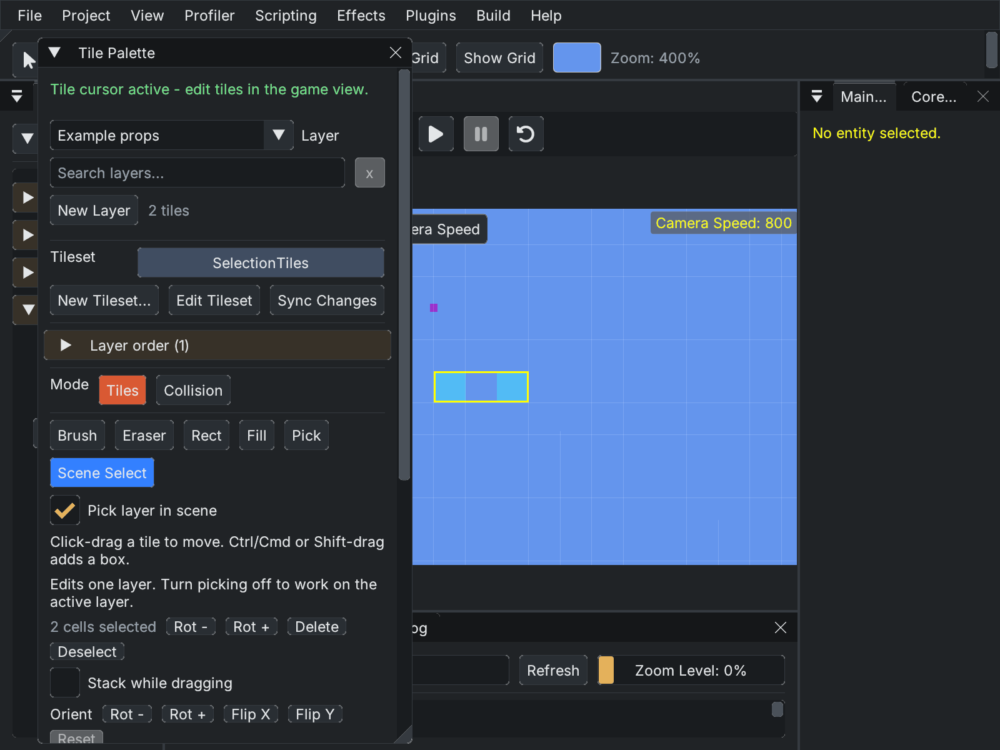

# Selecting and Moving Scene Tiles

**Scene Select** in the [Tile Palette](tile-palette.md) moves, rotates and deletes tiles already placed on a layer, in Edit mode. It edits cells on one layer at a time. Picking in the palette's source atlas only builds a brush stamp, and the ordinary transform tools move the whole layer entity.

Outside tile mode, double-clicking a layer's artwork selects the layer entity for inspection. The view stays where you clicked instead of jumping to the layer's origin.

*Two separated cells selected on one layer. A move keeps the empty cell between them. The palette reports two selected cells.*

## Select and move

1. Choose **Scene Select**. This turns on the tile cursor in the game view.
2. Drag from an empty cell to draw a selection box. Only occupied cells inside it are selected: cells with tiles or collision.
3. To start a box on top of artwork, or to add more boxes, hold Ctrl/Cmd or Shift while dragging.
4. Drag any selected cell to move the whole selection by whole cells. Selected cells are outlined in cyan and their destinations in green while you drag.

Click-dragging an occupied cell that is not selected selects just that cell and moves it straight away. For a prop that spans several cells, such as a chair, box-select all of its cells first, then drag one of them. For a room section, box the walls and props, then drag. Empty cells inside a box stay empty and never erase what is at the destination.

## Which layer

With **Pick layer in scene** on (the default), clicking an occupied cell switches to the frontmost visible layer that has a tile there. Hidden and disabled layers are skipped, and only occupied cells count, not a sparse layer's whole bounding box. Additive boxes stay on the current layer.

To work on a layer that sits behind other artwork, turn **Pick layer in scene** off and choose the **Layer** in the palette.

## Overlap rules

A cell's whole tile stack, its orientation and its collision move together; a single tile within a stack cannot be selected on its own. A move may overlap the selection's own starting cells. If any destination cell holds other tiles or collision on the same layer, the whole move is refused, the palette says why, nothing changes and no undo step is added. Other layers are never touched.

When the layer's **Build colliders on start** is on, its colliders are rebuilt after every move, rotation or deletion.

## Rotate, delete, cancel and undo

- **Rot -** and **Rot +**, or Q and E with the palette focused, turn the selected block a quarter turn around its centre and rotate each tile with it. The same destination check applies.
- **Delete**, or the Delete or Backspace key, clears the selected cells and their collision. Text fields keep their usual keys.
- **Deselect** clears the selection. Choosing another layer or loading another scene clears it too.
- **Escape** cancels a drag and clears the selection without moving anything. Leaving the game view cancels an unfinished box or drag, so a release outside it never applies a stale move.
- Each move, rotation or deletion is one scene undo step (Ctrl/Cmd+Z and Ctrl/Cmd+Y by default). Undoing or redoing a move or rotation also restores the selection, as long as the same layer is active.

A selection never creates colliders. Save the scene to keep the changes.
