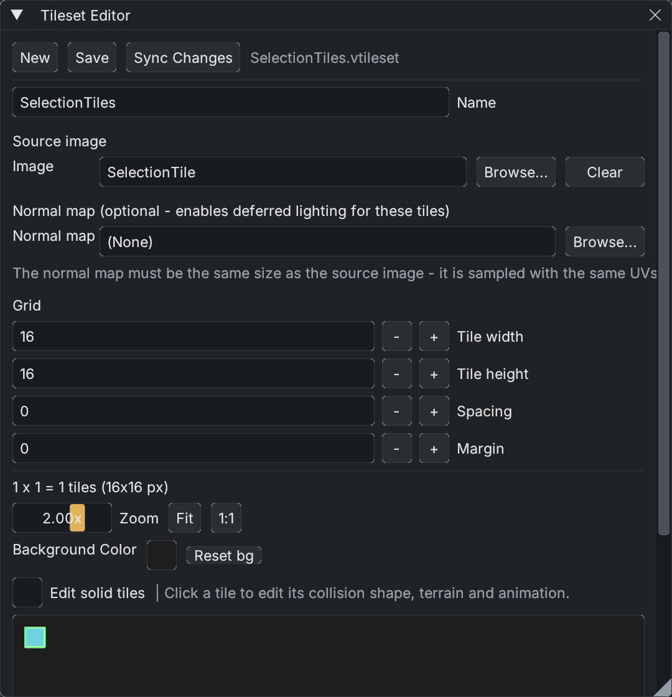

# Tilesets

A `.vtileset` slices source art into a tile grid and stores shared metadata. A scene's `TilemapRenderer` places those tile indices on one layer. The [Tile Palette](tile-palette.md) chooses what to paint; the Tileset Editor defines the source itself.

*Example tileset: one 16×16 PNG tile, with zero spacing and margin. The normal-map slot is optional.*

## Create and use a tileset

1. Open **View > Window > Tileset Editor**, or choose **New Tileset** in the Tile Palette.
2. Assign a PNG or Aseprite source. For Aseprite, choose the source layers and frame/animation settings you need.
3. Set **Tile width**, **Tile height**, **Spacing** and **Margin** to match the artwork. These describe the atlas, not the scene camera.
4. Choose a name and save the `.vtileset` in the project. Tile metadata uses atlas indices, so changing the grid later can change what existing painted cells display.
5. In the Tile Palette, assign the tileset and choose **New Layer**, or drop a tileset asset into the game view to create a layer. Each layer has its own scene cells, render order and collision mask.

Use **Edit Tileset** to reopen the active layer's asset. **Fit** shows the whole atlas and **1:1** restores native scale. Per-tile settings include a name, **Solid**, collision shape, one-way behavior, animation frames and terrain membership. Named custom collision polygons are reusable among tiles; terrain masks describe which tile fits its neighbors. For related lighting workflows, see [Room Light](../graphics/room-light.md) and [Animated Normal Maps](../graphics/animated-normal-maps.md).

## Source changes and collision

After editing source art externally, press **Sync Changes** in either tile window. It rereads the source and reloads the tileset on scene layers. Keep tile dimensions and atlas layout stable when replacing art; reordering source tiles can make old tile indices refer to different artwork. See [Live Aseprite Integration](aseprite.md) for the connected art workflow.

**Solid** and collision shape are tileset metadata. The scene layer's collision mask determines which placed cells contribute collision; it can be painted separately or generated from tiles. Changing collision metadata can rebuild colliders on affected layers. A rectangular tile selection is an editing gesture and does not add physics colliders.

Tileset **Save** writes an asset file. Scene painting, movement and collision edits use the scene undo history; do not treat that history as a substitute for backing up source art or tileset files.

Continue with [Tile Palette](tile-palette.md) for painting and [Scene tile selection](tile-selection.md) for moving placed art.
