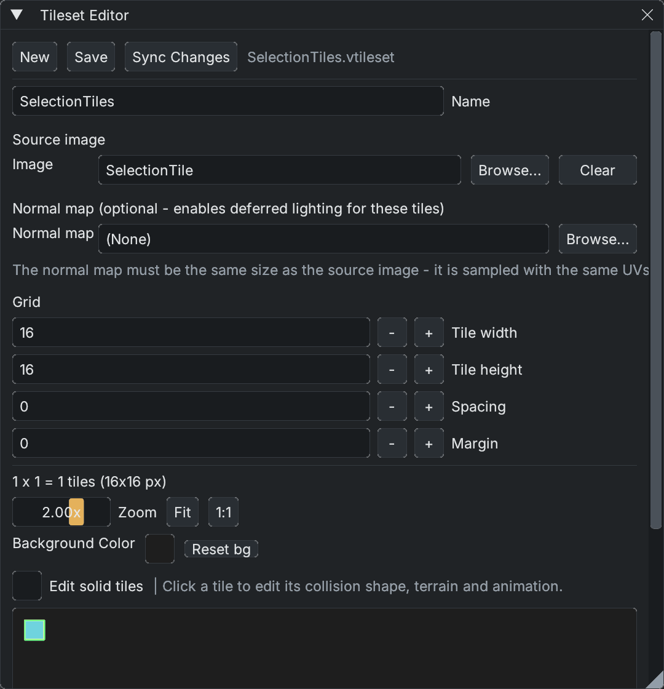

# Tilesets

A `.vtileset` slices source art into a grid of tiles and stores what each tile means: collision, terrain and animation. A scene's `TilemapRenderer` places those tiles on one layer. The Tileset Editor defines the tileset; the [Tile Palette](tile-palette.md) paints with it.

*Example tileset: one 16×16 PNG tile, with zero spacing and margin. The normal-map slot is optional.*

## Create a tileset

1. Open **View > Window > Tileset Editor** and press **New**, or press **New Tileset** in the Tile Palette. An existing `.vtileset` opens with **Load** or from the Asset Browser.
2. Enter a **Name** and choose the **Save to** folder. The folder is remembered for the next tileset.
3. Under **Source image**, browse for a PNG or an Aseprite file.
4. Set **Tile width** and **Tile height** (16 by default), **Spacing** between tiles and **Margin** around the sheet, to match the artwork. These describe the atlas, not the scene camera.
5. Press **Save**. The toolbar shows the file name, with `*` while there are unsaved changes.

The preview shows the sliced grid and the tile count. Use the **Zoom** slider, **Fit** to show the whole atlas, or **1:1** for native size.

### Aseprite sources

Choosing an `.aseprite` opens a layer and frame picker:

- **Layers**: tick the layers to flatten, or leave all visible layers in. With **Sync layers added later** on, the tileset follows the file and only the layers you untick are left out.
- **Frame**: the frame the atlas is taken from.
- **Create as animated tile**: packs a **Start / end frame** range into a strip, sets the tile size to the frame size, and makes tile 0 cycle through the frames. Paint tile 0 to place the animation.

**Layers** under the image slot reopens the picker later.

### Normal map

The optional **Normal map** slot takes a PNG or Aseprite image with the same pixel size as the source; it is sampled with the same UVs. It gives the tiles directional shading under deferred lights, which needs **Deferred lighting** turned on in **Project > Settings > Rendering Layers**. See [Animated Normal Maps](../graphics/animated-normal-maps.md) for the colour convention and [Voltage Normals](voltage-normals.md) for painting normals in Aseprite.

## Per-tile settings

Click a tile in the preview to edit it:

| Setting | Use |
|---|---|
| Collision shape | Box, None, four slopes (floor rising right or left, ceiling right or left), Circle or Custom |
| One-way platform | Blocks from above only; passes through from below and the sides |
| Custom collider | A named polygon drawn on a tile with **New**, editable with **Edit**, and reusable by other tiles in the tileset |
| Autotile terrain | **+ New terrain**, the terrain the tile **Belongs to**, and a 3 by 3 grid of the neighbours that must share that terrain for this tile to be chosen |
| Animation | **Add first frame (self)**, then **Add frame**, or **Pick frames by clicking** in the preview. **Frame seconds** sets the time per frame (0.15 by default) |

Turn on **Edit solid tiles** and click tiles (or hold Ctrl) to flag them **Solid**. Box tiles greedy-merge into larger colliders; slope, circle and custom tiles each add their own.

Solid flags and shapes are tileset data. Which placed cells actually collide is decided by each layer's collision mask, which you paint or generate in the Tile Palette's **Collision** mode (**Solid from flagged tiles** reads these flags). Selecting tiles in the scene never adds colliders.

## Updating the source art

After editing the source image outside Voltage, press **Sync Changes** in the Tileset Editor or the Tile Palette. It rereads the image (and normal map) from disk and reloads every layer in the open scene that uses the tileset. Tile settings are kept. Saving a `.vtileset` also reloads the scene layers that use it.

If an Aseprite source gained layers, a tileset whose layer list already named every layer switches to following the file. One that leaves layers out keeps its list and logs which layers are not included; tick them under **Layers**, or turn on **Sync layers added later**.

Tiles are numbered by their position in the grid, row by row. Keep the tile size and the atlas layout stable when you replace art: moving tiles around, changing the column count or changing the grid settings makes painted cells show different tiles. Tile settings follow the same numbers.

## Saving and undo

**Save** writes the `.vtileset` file. Painting, moving and collision edits in the scene go into the scene's undo history and are saved with the scene. Neither replaces a backup of the source art or the tileset file.

Continue with [Tile Palette](tile-palette.md) for painting and [Selecting and Moving Scene Tiles](tile-selection.md) for rearranging placed tiles. For tilemaps in code, see [Tilemaps](../scripting/tilemaps.md).
