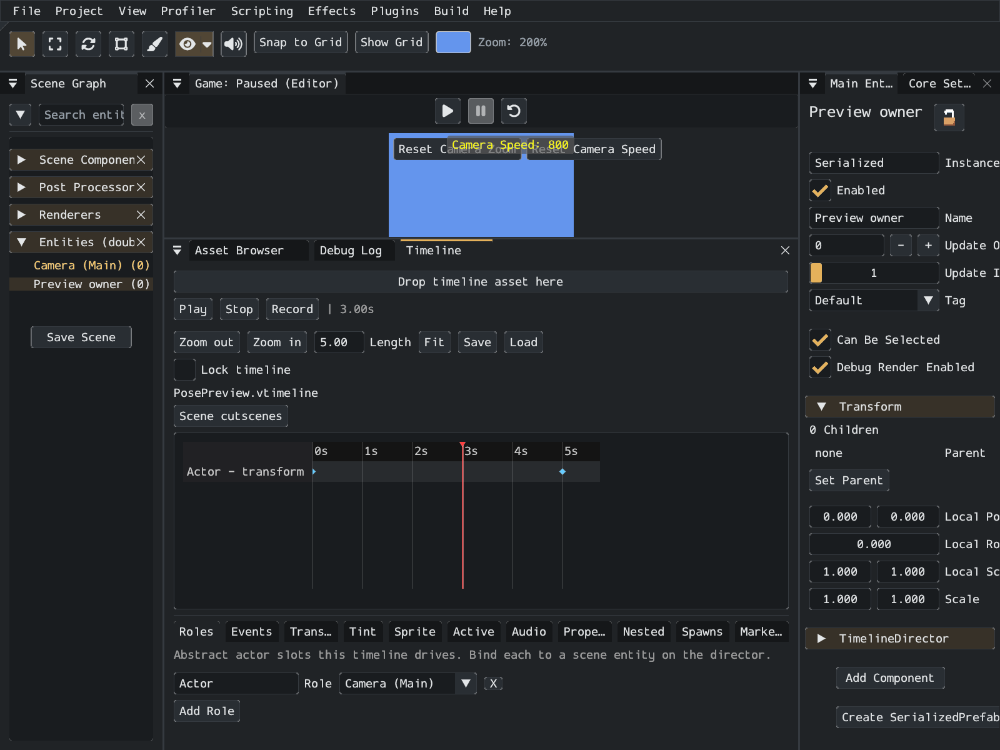
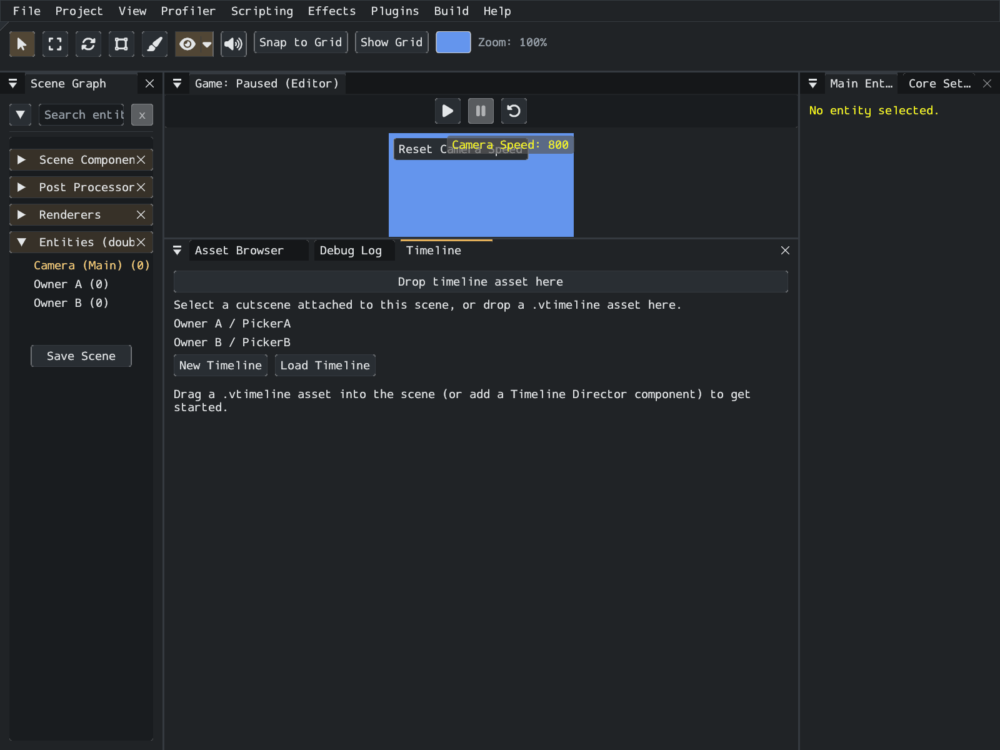

# Timeline Editor

*An example five-second asset with one Actor role. Bind roles to scene entities before previewing tracks that target them.*

Open **View > Window > Timeline Editor**. When no cutscene is open, the window lists the Timeline Directors attached to entities in the **currently loaded scene**. Choose a row to select its owning entity and open its timeline. The list follows scene changes, renamed and deleted entities; identical display names remain separate entries. **Scene cutscenes** returns to this list.

Selecting an entity with a **Timeline Director** also opens its timeline. Enable **Lock timeline** to keep the current director's document open while selecting other entities. Unlock it to follow entity selection again.

Drag a `.vtimeline` from the Asset Browser onto **Drop timeline asset here** to inspect and edit its tracks without creating an entity or assigning it to a director. This standalone document needs a compatible director in the current scene for preview: choose **Preview with [entity name]** when that director already references the same asset. Its scene bindings supply the track targets. Dropping a timeline into the game view is a separate workflow that creates a director.

Use **New Timeline** or **Load Timeline** to create or open an asset. Native file dialogs require platform support; the Asset Browser drop zone provides another way to open an existing project asset. Timeline roles belong to the reusable `.vtimeline`; the director's role bindings connect them to entities in this scene. The header reports missing bindings.

**Play** and **Pause** advance or hold the preview playhead in Edit mode. Click or drag the ruler to scrub forward or backward. Preview samples transform, camera, tint, activation, sprite-animation and supported property tracks, including supported tracks in nested timelines. Components can supply reversible presentation through `ITimelinePreviewParticipant`, for example cinematic text and overlays. **Stop** restores the scene's pre-preview state and resets the playhead.

Preview does not run ordinary gameplay events, broadcast signals, prefab spawning, component lifecycle callbacks or audio playback. Unknown custom tracks and nesting beyond eight levels are omitted. The header's **Preview omits** message identifies omissions. Test those effects in game Play mode. Preview poses are restored when switching or closing the document, leaving the scene, or saving scene data; scrubbing does not save its temporary pose into the scene.

**Zoom in/out** changes the time axis; Ctrl/Cmd plus scrolling over the canvas also zooms it. Drag the divider below the canvas to change its height. Drag a key or clip to change its time; range edges change its start or end. **Length** sets playback duration. Content past it does not play; **Fit** sets Length to the last content item.

**Record** captures changes to bound entity transforms and camera zoom at the current playhead. Scrub first, enable Record, then move the entity or adjust its camera zoom. Playback disables recording. The tabs cover roles, events, transforms, tint, sprite animation, activation, audio, component properties, nested timelines, prefab spawns and markers. Property tracks require members marked `[TimelineProperty]`; supported types are `float`, `Vector2` and `Color`.

An asterisk beside the filename marks unsaved timeline edits. **Save** writes that `.vtimeline`; save the scene separately to retain director bindings and asset assignment. Switching documents, closing the window, changing scenes or exiting with dirty timeline edits presents **Save**, **Discard** and **Cancel**. Cancel keeps the working document and restores its selection. A failed save leaves the prompt open with an error. External file changes preserve a dirty working copy. Timeline window edits do not currently provide a general undo history, so keep a saved copy before extensive edits.

The window's docking, size, visibility and active tab are remembered automatically. See [Editor Layouts](layouts.md).
