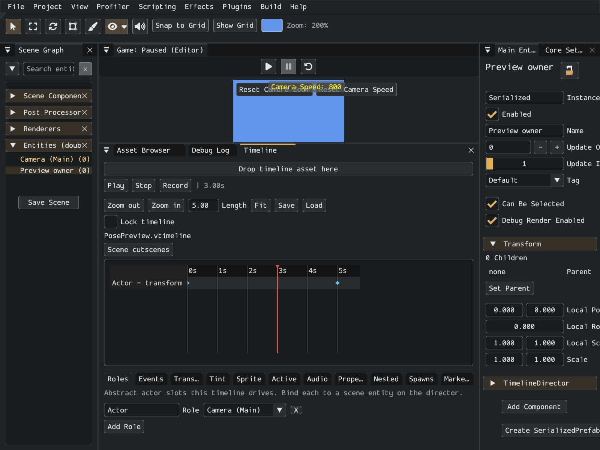
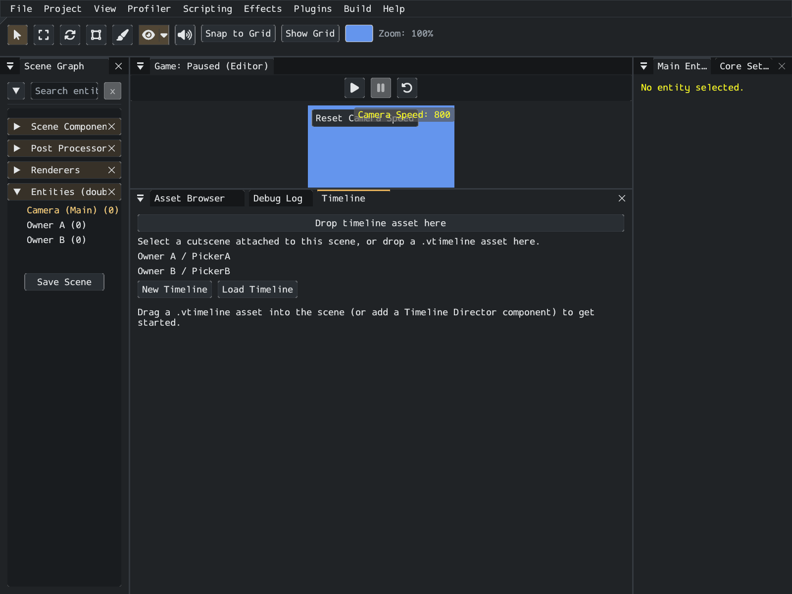

# Timeline Editor

The Timeline Editor authors cutscenes: reusable `.vtimeline` assets played in a scene by a **Timeline Director** component.

*An example five-second asset with one Actor role. Bind roles to scene entities before previewing tracks that target them.*

## Open a timeline

Open **View > Window > Timeline Editor**. With no cutscene open, the window lists the Timeline Directors in the **currently loaded scene**. Choose a row to select its entity and open its timeline. The list follows scene changes and renamed or deleted entities, and entries with the same display name stay separate. **Scene cutscenes** returns to the list.

Selecting an entity with a Timeline Director also opens its timeline. Turn on **Lock timeline** to keep the current director's timeline open while you select other entities; turn it off to follow the selection again.

Drag a `.vtimeline` from the Asset Browser onto **Drop timeline asset here** to edit its tracks without creating an entity or changing any director. To preview it, the scene needs a director that already uses the same asset: choose **Preview with** followed by that entity's name, and its bindings supply the track targets. Dropping a timeline into the game view instead creates a director for it.

**New Timeline** and **Load Timeline** create or open an asset through the native file dialog, where the platform supports one; the Asset Browser drop zone also opens existing assets.

## Roles and bindings

Roles belong to the reusable `.vtimeline`. A director's role bindings connect each role to an entity in its scene, so one timeline can run with different actors. The header lists roles that have no binding. Bindings are saved with the scene, not the timeline.

## Preview

**Play** and **Pause** run or hold the preview playhead in Edit mode. Click or drag on the ruler to scrub in either direction. **Stop** restores the scene to its state before the preview and resets the playhead. Preview closes when you enter Play mode.

Preview samples transform, camera zoom, tint, activation, sprite animation and property tracks, including those inside nested timelines. Components can add their own reversible preview through `ITimelinePreviewParticipant`, as cinematic text and overlays do.

Preview does not run gameplay events, broadcast signals, prefab spawns, component lifecycle callbacks or audio, and it skips unknown custom tracks and nesting deeper than eight levels. The header's **Preview omits** line names what was left out; test those in Play mode. The preview pose is restored when you switch or close the timeline, leave the scene or save scene data, so scrubbing never saves a temporary pose into the scene.

## Editing

**Zoom in** and **Zoom out** scale the time axis; Ctrl/Cmd plus the mouse wheel over the canvas does the same. Drag the divider below the canvas to change its height. Drag a key or clip to move it in time, and drag a clip's edge to change its start or end. **Length** sets the playback duration; anything past it never plays, and a warning shows when content runs longer. **Fit** sets Length to the end of the last key, clip, event or marker.

**Record** captures changes to bound entities at the playhead. Scrub to a time, turn on Record, then move an entity or change its camera's zoom, and a key is written. Starting playback turns recording off.

The tabs below the canvas hold the tracks:

| Tab | Contents |
|---|---|
| Roles | The timeline's roles and this scene's bindings for them |
| Events | Calls to component methods marked `[TimelineEvent]` at a time; ranged clips call a begin and an end method. **Broadcast** sends a signal to game code, and **On Skip** chooses whether the event is dropped or still runs when the player skips |
| Transform | Position, rotation and scale keys per role |
| Tint | Colour keys per role |
| Sprite | Animation clips played on a role's `SpriteAnimator` |
| Active | Ranges during which a role is enabled, or disabled with the invert option |
| Audio | Sound clips with volume and bus |
| Property | Keys for component members marked `[TimelineProperty]`; supported types are `float`, `Vector2` and `Color` |
| Nested | Other timelines played as clips at a speed. Nested timelines are cached: press **Reload Nested** after editing one |
| Spawns | Prefabs spawned for a time range under a role that other tracks can target |
| Markers | Named points for navigation; game code can jump to one with `director.SeekToMarker("name")` |

## Saving

An asterisk beside the file name marks unsaved timeline edits. **Save** writes the `.vtimeline`; save the scene separately to keep the director's bindings and asset assignment. Switching timelines, closing the window, changing scenes or exiting with unsaved edits asks to **Save**, **Discard** or **Cancel**. Cancel keeps the working copy and the selection. A failed save keeps the prompt open and shows the error.

If the file changes on disk while you have unsaved edits, your working copy is kept. The Timeline Editor has no undo history of its own, so save a copy before large edits.

The window's docking, size, visibility and active tab are remembered with the layout. See [Editor Layouts](layouts.md).
