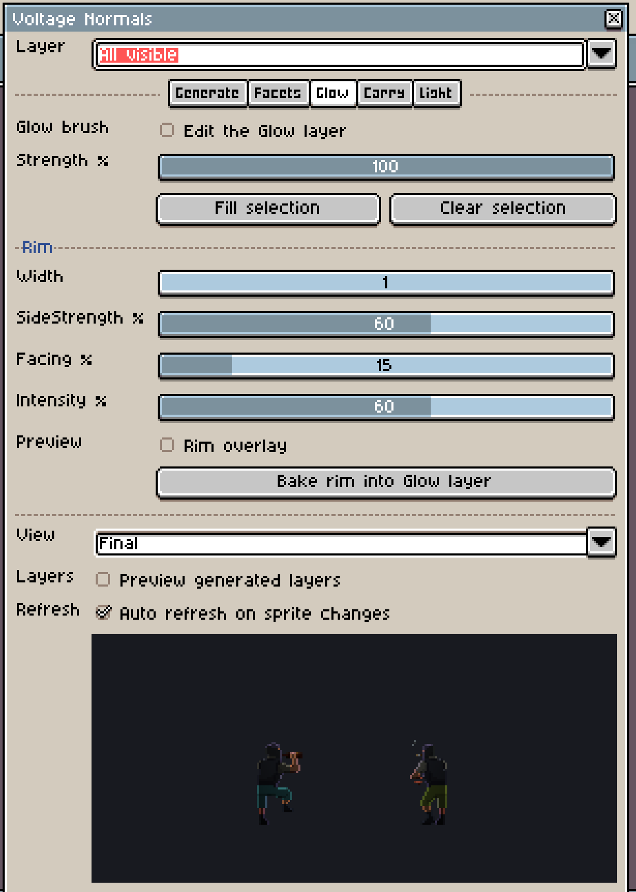

# Voltage Normals

Voltage Normals is a panel inside Aseprite, installed with the [Aseprite bridge](aseprite.md). Open it with **Edit > Voltage Normals** (Aseprite 1.3 or newer), or with **Open Voltage Normals in Aseprite** in Voltage's Aseprite window. Every button runs the same command as the matching `aseprite.normals_*` tool, so the panel and an agent produce identical results.

Aseprite's scripting API cannot dock, so the panel is a floating window. It sizes itself to Aseprite's screen and UI scaling when it opens; reopen it after changing them. Aseprite dialogs have no tooltips, so **Tips** lists what each setting on the current tab does.

The **Layer** selector at the top picks the art layer to work on. **All visible** makes Generate and rim baking cover every visible art layer.

## Layers and palette

Normals live in hidden `Normals-<layer>` layers beside the art, and self-illumination in hidden `Glow-<layer>` layers. Each normal cel matches its art cel's alpha, position and frame. These are the layers [Animated Normal Maps](../graphics/animated-normal-maps.md) reads in the game.

Maps are flat and faceted, one colour per facet:

| Facet | RGB |
|---|---|
| front | 128, 128, 255 |
| left | 58, 128, 234 |
| right | 198, 128, 234 |
| top | 128, 198, 234 |
| bottom | 128, 58, 234 |

Green above 128 faces up, as in the engine. The diagonals, up-left (79, 177, 234), up-right (177, 177, 234), down-left (79, 79, 234) and down-right (177, 79, 234), are only used when **Diagonal facets** is on.

## Generate

**Generate** fills every opaque pixel with the front facet and bevels the silhouette according to the side each edge faces.

| Setting | Effect |
|---|---|
| Preset | Starting values for Character, Prop or Wall-tile |
| Bevel width | How many pixels in from the edge get side facets (1 to 4) |
| Merge Outlines | Dark outline pixels take the facet of the shape they wrap |
| Split large clusters | Adds side facets inside large flat areas, for planar folds |
| Split from (px) | Smallest area that gets split |
| Diagonal facets | Allows the four in-between directions |
| Frames | This frame, This tag or All frames |
| Overwrite Normals | Replace the existing `Normals-<layer>` |

With **Overwrite Normals** off, an existing `Normals-<layer>` is left alone and the result goes to a new `Normals-<layer>-gen` layer. Turn on **Preview generated layers** to see it in the preview, and rename it when you want to keep it.

## Facets

Pick a facet in the grid, then **Apply to selection**. **Average selection** replaces the selection with the facet nearest its average normal. **Select cluster** waits for a click on the sprite and selects the connected pixels of the same art colour; **Cluster** chooses whether that replaces, adds to or removes from the selection.

**Validate** checks every Normals and Glow layer. Wrong alpha, bounds, frames and off-palette colours are errors; silhouette pixels with no bevel are warnings.

## Glow and rim

**Edit the Glow layer** shows the matching `Glow-<layer>`, makes it active and sets the foreground colour, so Aseprite's own pencil paints glow at the chosen **Strength %**. Strength is the brightest colour channel times alpha, which is why the tint does not change it. **Fill selection** and **Clear selection** work on the selection, clipped to the art's alpha.

The Rim section computes a pixel rim from the silhouette and normals. **Width** sets how deep it reaches, **SideStrength %** how bright the left and right edges are (the top is always full), and **Facing %** how directly a facet must face outward to catch it. **Intensity %** only affects the preview. **Rim overlay** shows the rim before you commit it, and **Bake rim into Glow layer** writes it into the Glow layers on every frame, keeping any stronger glow already painted.

## Carry

To reuse one frame's work across a tag, open a finished frame and press **Record this frame**, choose **Apply to** (This tag or All frames), then **Preview diff**. Clusters on the other frames are matched by colour, size and position, and the strip marks in magenta the pixels that would change. **Apply** writes the normals, and the glow where a Glow layer exists. Clusters with no match keep what they have.

## Lit preview

The preview canvas is a CPU copy of the engine's lighting: the same normal decode and Y flip, N·L shading, linear falloff, light height, ambient and self-illumination, plus the fluorescent bar shader. Drag on it to move the light, or turn on **Light follows the mouse**.

The **Light** tab holds the light presets (Fluorescent bar above, Warm room fill, Cable spark), **Colour**, **Height**, **Radius**, **Intensity %** (above 100 overexposes, useful for sparks) and **Ambient**. **View** switches between Final, Normals and Glow, and **Auto refresh on sprite changes** redraws after edits; turn it off if it lags. For the real renderer and every light type, use [Light Preview](light-preview.md).

## Tools

The panel's commands are available as `aseprite.normals_*` in the CLI and `aseprite_normals_*` over MCP.

| Tool | Does |
|---|---|
| `normals_generate` | Writes `Normals-` layers from presets and options; `overwrite` must be explicit |
| `normals_apply`, `normals_average` | Set the selection to a facet, or to the nearest facet of its average |
| `normals_select_cluster` | Selects an art cluster at a point: replace, add or remove |
| `normals_validate` | Reports errors, warnings and per-layer totals |
| `normals_glow` | `edit`, `strength`, `fill` and `clear` for the Glow layer |
| `normals_rim` | Returns the rim as an image, or bakes it with `bake=true` |
| `normals_carry` | Dry run with a diff strip; writes with `apply=true` |
| `normals_preview` | Returns the lit, normal or glow view as a PNG |
