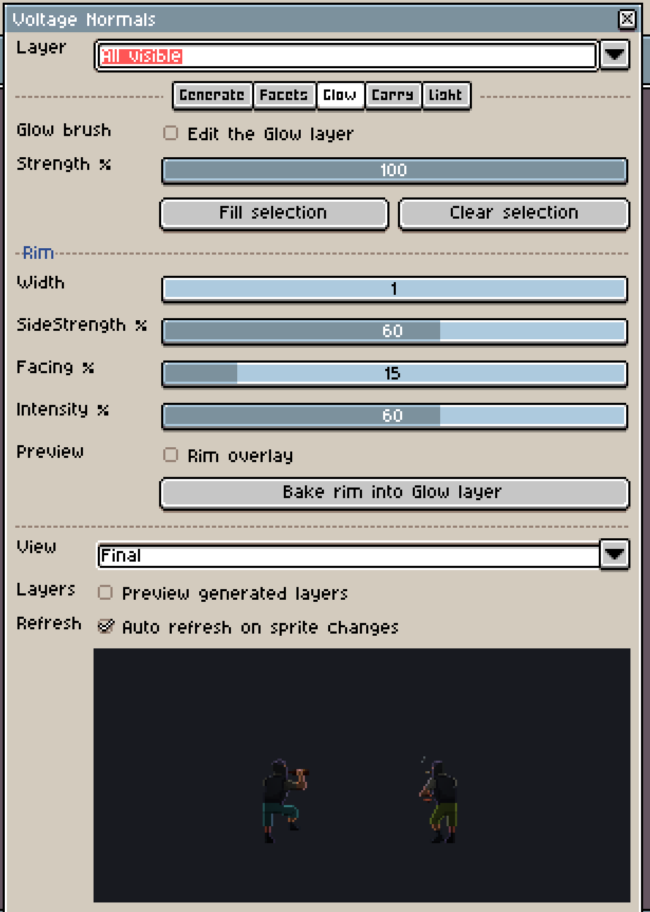

# Voltage Normals

Voltage Normals is part of the [Aseprite bridge](aseprite.md). Open it with **Edit > Voltage Normals** in Aseprite. Every button calls the same command the `aseprite.normals_*` tools run, so a panel session and an agent produce identical results. Aseprite's scripting API has no docking, so the panel is a floating window. It sizes itself to the current Screen and UI Scaling when it opens; reopen it after changing them.

## Layers and palette

Normals are hidden `Normals-<layer>` layers beside the art, and self-illumination is a hidden `Glow-<layer>`. Each normal cel matches its diffuse cel's alpha, position and frame. Maps are flat and faceted, with one colour per facet:

| Facet | RGB |
|---|---|
| front | 128, 128, 255 |
| left | 58, 128, 234 |
| right | 198, 128, 234 |
| top | 128, 198, 234 |
| bottom | 128, 58, 234 |

Green above 128 faces up, matching the engine. The diagonals, up-left (79,177,234), up-right (177,177,234), down-left (79,79,234) and down-right (177,79,234), stay off unless **Diagonal facets** is on.

## Generate

**Generate** fills every opaque pixel with the front facet and bevels the silhouette by the side it faces. **Bevel width** sets the depth. **Merge Outlines** gives dark outline pixels the facet of the surface they wrap. **Split large clusters** adds side facets to large same-colour areas, for planar folds. The presets Character, Prop and Wall-tile load starting values.

An existing `Normals-<layer>` is never replaced unless **Overwrite Normals** is on. Otherwise the result goes to a new `Normals-<layer>-gen` layer, and **Preview generated layers** shows it. Rename it when you want to keep it.

## Facets

Pick a facet in the grid, then **Apply to selection**. **Average selection** replaces the selection with the facet nearest to its average normal. **Select cluster** waits for a click on the sprite and selects the connected same-colour diffuse pixels, replacing, adding to or removing from the selection. **Validate** checks every Normals and Glow layer: alpha, bounds, frames and palette colours are errors, and unbevelled silhouette pixels are warnings.

## Glow and rim

**Edit the Glow layer** shows the matching `Glow-<layer>`, makes it the active layer and sets the foreground colour, so Aseprite's own pencil paints glow at the chosen **Strength**. Strength is the brightest colour channel times alpha, which is why the tint does not change it. **Fill selection** and **Clear selection** work on the selection, clipped to the diffuse alpha.

The Rim section computes a pixel rim from the silhouette and normals, with Width, SideStrength and Facing. **Rim overlay** previews it, and **Bake rim into Glow layer** writes it across the chosen frames, keeping any stronger glow already painted.

## Carry

To reuse one frame's work across a tag, press **Record this frame** on a finished frame, then **Preview diff**. Clusters on the other frames are matched by colour, size and position, and the strip shows pixels that would change in magenta. **Apply** writes the normals, and the glow when the layer exists. Unmatched clusters keep what they have.

## Lit preview

The canvas is a CPU copy of the engine's lighting: the same normal decode and Y flip, N·L, linear falloff, light height, ambient and self-illumination, plus the fluorescent bar shader. Drag on it to move the light, or turn on **Light follows the mouse**. The light presets are Fluorescent bar above, Warm room fill and Cable spark. **View** switches between Final, Normals and Glow, and **Auto refresh** follows sprite edits. For the real renderer and every light type, use the [Light Preview](light-preview.md) window.

## Tools

| Tool | Does |
|---|---|
| `normals_generate` | Writes `Normals-` layers from presets and options; `overwrite` must be explicit |
| `normals_apply`, `normals_average` | Set the selection to a facet, or to the nearest facet of its average |
| `normals_select_cluster` | Selects a diffuse cluster at a point: replace, add or remove |
| `normals_validate` | Reports errors, warnings and per-layer totals |
| `normals_glow` | `edit`, `strength`, `fill` and `clear` for the Glow layer |
| `normals_rim` | Returns the rim as an image, or bakes it with `bake=true` |
| `normals_carry` | Dry run with a diff strip; writes with `apply=true` |
| `normals_preview` | Returns the lit, normal or glow view as a PNG |
