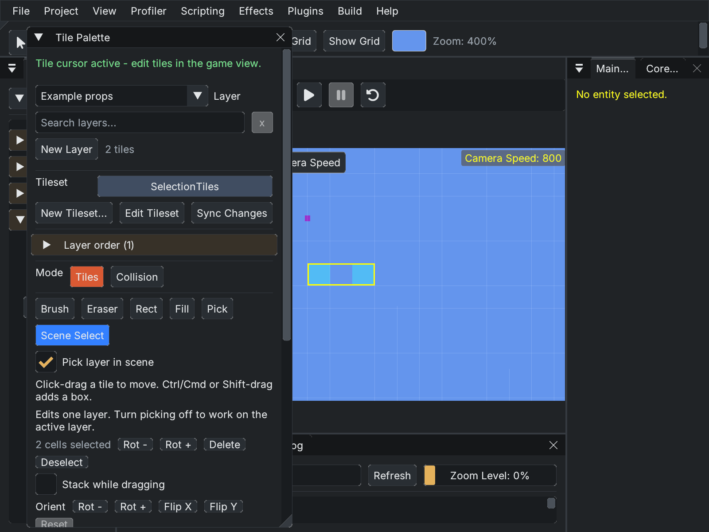

# Main Windows

*Example workspace: Scene Select is active, while the Inspector has no entity selected. Tile selection and entity selection are separate.*

The menu bar holds **File**, **Project**, **View**, **Profiler**, **Scripting**, **Effects**, **Plugins**, **Build** and **Help**. When the editor window is too narrow, the menus that do not fit move into **More**. Plugins can add their own items to any of these menus.

## Windows

| Window | Open from | Purpose |
|---|---|---|
| **Scene Graph** | View > Window > Scene Graph Window | The active scene in four sections: Scene Components, Post Processors, Renderers and Entities. The arrow button at the top shows or hides sections. Right-click an entity to rename, duplicate, destroy, create a child, paste a copied component, open it in a separate inspector, or **Move Camera Here**. Post-processors added here apply live but are not saved in the scene file. |
| **Main Entity Inspector** | View > Window > Inspector Window | Name, transform and components of the selected entity, **Add Component**, prefab creation and prefab overrides. See [Scenes and Prefabs](scenes-and-prefabs.md). |
| **Asset Browser** | View > Window > Asset Browser | Project files, `.meta` GUIDs, drag and drop into the scene and inspector. See [The Asset Browser](asset-browser.md). |
| **Game** | View > Window > Separate Game Window (on by default) | The game view as a dockable window. Its title reads **Playing**, **Paused**, or **Paused (Editor)** in Edit mode. With the option off, the game draws behind the dock layout instead. See [Play, Pause, Reset](play-mode.md). |
| **Editor Tools** | Always shown | Cursor tools, debug overlays, audio mute, snapping, zoom, camera speed and Play View. Holds the playback buttons when Separate Game Window is off. |
| **Debug Log** | Always shown | Editor, script and engine messages. **Collapse Text**, **Group Logs** (merges repeats with a count), **Clear**, and **Max Messages** (default 350). Script compile errors appear here; see [Hot Reload](hot-reload.md). |
| **Tile Palette** | View > Window > Tile Palette, or the Tile Brush cursor | Active tilemap layer, brush source and scene tile tools. See [Tile Palette](tile-palette.md). |
| **Tileset Editor** | View > Window > Tileset Editor, or double-click a `.vtileset` | Tile size, source art, animation, terrain and collision data. See [Tilesets](tilesets.md). |
| **Timeline** | View > Window > Timeline Editor, or double-click a `.vtimeline` | Sequences played through a scene's Timeline Director. See [Timeline Editor](timelines.md). |
| **Animation Event Inspector** | View > Window > Animation Event Inspector | Events on sprite animation frames. See [Animation Event Inspector](animation-events.md). |
| **Aseprite** | View > Window > Aseprite | Live link to Aseprite. See [Live Aseprite Integration](aseprite.md). |
| **Light Preview** | View > Window > Light Preview | Lights an Aseprite sprite through the deferred renderer. See [Light Preview](light-preview.md). |
| **Core Settings** | View > Window > Core Window | FPS graph and live engine switches. See [Core Settings](core-settings.md). |
| **Data Asset** | Double-click a `.vasset` | Edits shared data assets. See [Data Assets](data-assets.md). |
| **Scripting** | Scripting > Scripting Window | Hot reload switches, compile actions, loaded script types and the compile log. |
| **Editor Settings** | File > Settings | Interface scale, text size and font, script and effect options, snapping, and **Custom Hotkeys** for rebinding shortcuts. |
| **Project Settings** | Project > Settings | `ProjectSettings.json`. See [Projects](projects.md#project-settings). |
| **Build Game** | Build > Build Game | Standalone builds and the scene list. See [Build Game](game-build.md). |
| **Asset Build** | Build > Asset Build | MGCB compilation of Content. See [Asset Build](asset-build.md). |
| **Plugin Manager** | Plugins > Plugin Manager | Project plugins. See [Plugin Manager](plugin-windows.md). |
| **Audio Profiler**, **Performance Profiler** | Profiler | Live audio and runtime performance data. |
| **Sprite Atlas Editor** | File > Open Sprite Atlas Editor | Edits sprite atlases. |

View > Window also has **Preserve Game Window Aspect Ratio**. The Help menu holds the ImGui demo window and style editor.

## Docking and appearance

Drag a window's tab to dock or undock it, and drag a border to resize it. The dock arrangement and window visibility are saved when the editor closes; see [Editor Layouts](layouts.md) for named layouts and recovery.

The default theme is **Studio Graphite**. **View > Themes** changes the theme, and **View > Interface scale** (75% to 200%), **View > UI font** and **View > Code font** change readability independently. **File > Settings > Interface** adds a separate text size (80% to 160%).

## Editor Tools

The Editor Tools row contains, in order:

- **Cursor tools**: Default cursor for moving (`1` or `Q`), Resize Entities (`2` or `E`), Rotate Entities (`3` or `R`), Resize Bounds for colliders and lights (`4` or `T`), and Paint Tiles (`5` or `B`), which also opens the Tile Palette.
- **Debug overlays**: the eye button and its dropdown.
- **Audio mute**.
- **Snap to Grid** and **Show Grid**. Hold `Ctrl` while dragging to invert snapping. The grid size is in File > Settings > Placement Snapping (default 16 px).
- **Background colour**, **Zoom** and **Camera Speed**.
- **Play View**; see [Play View](play-mode.md#play-view).

Transform tools move whole entities. **Scene Select** in the Tile Palette works on individual placed cells; see [Scene tile selection](tile-selection.md).

The eye button shows or hides debug overlays. Its dropdown has **All** and independent categories for **Colliders**, **Sprite renderers**, **Tilemaps**, **Lights**, **UI**, **Other components** and **Transform gizmos**. Checked categories are visible. Clicking the eye hides the selected categories and the next click restores them. Category choices are editor preferences and do not modify scenes. The collider category includes tilemap-generated collision shapes independently of tilemap bounds.

## Navigating the scene

With the Game view focused in Edit mode, or while paused from the editor:

- **Mouse wheel** zooms. **Shift + wheel** changes camera speed.
- **Middle mouse drag** pans.
- **W A S D** pans (not while `Ctrl` is held). Hold **Shift** to double the speed.

With the Scene Graph focused in Edit mode, **Up** and **Down** select the previous or next entity through the whole hierarchy, including collapsed children, and repeat while held. Navigation follows the selected entity even when the inspector is locked, expands its ancestors and scrolls the row into view. Text fields keep their own arrow-key input.

Selecting an entity in the Scene Graph in Edit mode centres the camera on the combined bounds of its renderers, colliders and descendants. Tilemap layers use their painted cells rather than their shared origin. Empty layers do not pull a group toward the origin, and groups without content use their leaf positions. **Move Camera Here** and the gateway command `view.focus` use the same bounds.

The Inspector's **Debug Render Enabled** flag also gates every descendant. Turning a parent back on restores each child's own setting; it does not overwrite those settings or disable gameplay rendering.
