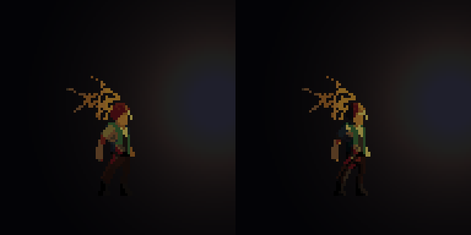

# Animated sprite normal maps



*Left: no normal maps, so the light only brightens the sprite evenly. Right: with `Normals-` layers, each frame is shaded by the direction of the light.*

A normal map tells the deferred lights which way each pixel of a sprite faces, so highlights and shaded sides follow the light as it moves. It changes shading only: it adds no cast shadows or geometry, and [Room Light](lights/room-light.md) fill ignores it.

## Requirements

- Turn on **Deferred lighting** in **Project > Settings > Rendering Layers**, then reload the scene. `AnimatedNormalMap` does nothing in a scene without a `DeferredLightingRenderer`.
- Lights only reach the sprite from the **Lighting** render layer. The [Lighting Overview](lighting.md) lists every light type.

## Set up a sprite

1. Add `AnimatedNormalMap` to an entity with a `SpriteAnimator` (it requires one).
2. Leave `Source` empty to read the animator's own Aseprite file, or assign a different `.aseprite` that holds the normals.
3. List the normal layer names in `Layers`, for example `Normals-Body`. Hidden layers are read; layers not listed are not.
4. Press **Reload** in the inspector after changing the file or the settings. The component also loads on scene start and when re-enabled.

The normal animations are looked up by the animator's current animation name, so the Aseprite tags must match the animator's animation names. A file with no tags gives a single animation named `Default`. The normal frame shown is the animator's current frame, so each tag needs the same number of frames as the art. An animation with no normals gets a flat, screen-facing normal.

## Paint the layers

Keep normal layers hidden in Aseprite so they never appear in the art. For each visible art layer, paint a matching normal layer on the same frames and canvas, keeping tags, frame order and poses. Give flat props and effects a front-facing normal rather than leaving them empty. The normal atlas may be packed differently from the art atlas; the material maps between them.

Normals are tangent-space XYZ stored in RGB: (128, 128, 255) faces the viewer, red above 128 faces right and green above 128 faces up. A pixel with G = 198 brightens under a light above it and darkens under one below. Keep the vector normalized and the pixels opaque wherever the art is visible. Sprite flips, negative scale and rotation turn the normals with the sprite.

[Voltage Normals](../editor/voltage-normals.md) generates, paints and checks these layers inside Aseprite, and [Light Preview](../editor/light-preview.md) shows the result through the real renderer.

## Glow

Add a hidden `Glow-<layer>` beside a `Normals-<layer>` to make pixels light themselves. Strength is the brightest colour channel times alpha, so grey and tinted pixels both work, from none to fully lit. The glow is packed into the normal texture's alpha and enables self-illumination only while an animation that has glow is playing. Glow painted outside the normal layer's pixels gets a front-facing normal. Glow does not remove ambient light, which the final combine still adds on top.

## Several source files

When the animator's animations come from several Aseprite files, add an entry to `Clips` for each:

| Field | Meaning |
| --- | --- |
| `Animation` | The animator's animation name |
| `Source` | The `.aseprite` holding its normals |
| `Tag` | The Aseprite tag to use; leave empty only for an untagged file |
| `Layers` | The normal layers to read |

A clip entry replaces the normals the main `Source` would give the same animation.

## Code

`Content.LoadAsepriteNormalAtlas(path, layers)` loads normal layers with their glow packed in, the same way the component does. Atlases from content are shared by path and layer selection, and identical frames reuse one atlas region, so never dispose them. `DeferredAnimatedMaterial` takes one normal `SpriteAnimation` or a dictionary keyed by animation name:

```csharp
var atlas = Entity.Scene.Content.LoadAsepriteNormalAtlas("Content/Actor.aseprite", new[] { "Normals-Body" });
var normals = new Dictionary<string, SpriteAnimation>();
foreach (var name in atlas.AnimationNames)
    normals[name] = atlas.GetAnimation(name);
animator.SetMaterial(new DeferredAnimatedMaterial(animator, normals));
```

The component owns only its material: it disposes it and restores the animator's previous material when disabled or removed.

## Painting tips

Start with restrained volumes for limbs, clothing and faces, and judge them under a moving side light across the whole animation. Do not derive height from painted brightness: dark clothing and baked shadows are not recesses.
