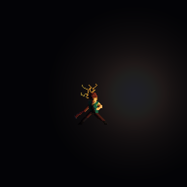
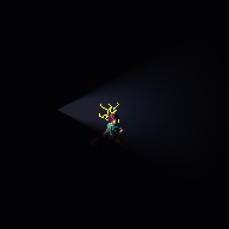
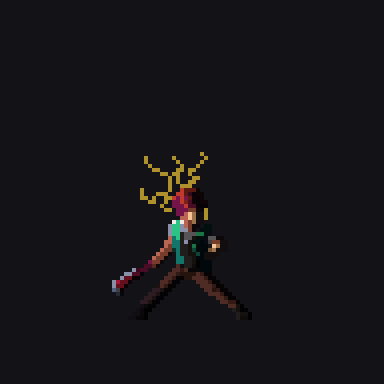
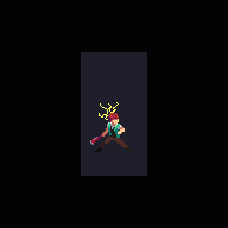
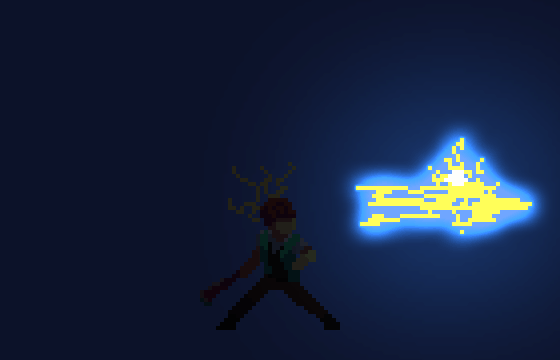
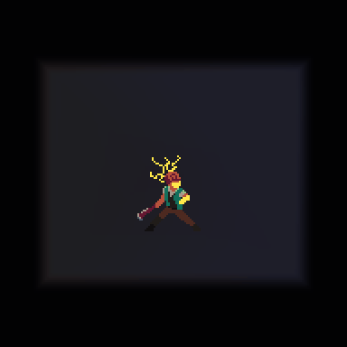
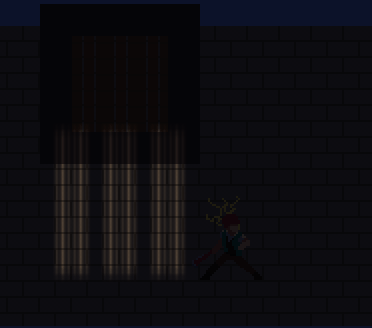
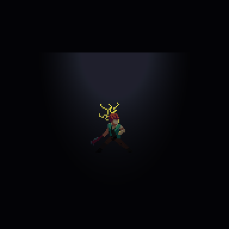
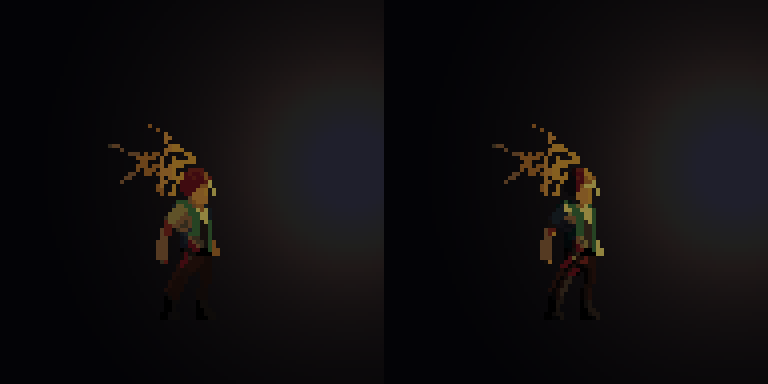

# Lighting Overview

Voltage lights pixel art with a deferred renderer: sprites and tilemaps draw their colour and normal maps into separate buffers, lights accumulate into a light buffer that reads those normals, and a final pass combines them with an ambient colour. Lights shade the art instead of painting over it, so a lamp brightens the side of a character that faces it.

## Turning it on

1. Open **Project > Settings**, go to **Rendering Layers**, check **Deferred lighting** and choose the **Ambient light** colour. Dark ambient makes lights stand out.
2. Put every light on the **Lighting** render layer (value -100 by default). Only light components may use that layer.
3. Give sprites normal maps where you want directional shading (below). Sprites without one are lit evenly.

With deferred lighting on, each scene sets up a `DeferredLightingRenderer` for every layer except Lighting, InFrontOfAll and UIElement. InFrontOfAll draws unlit on top, and UI is never lit. In code, `scene.GetRenderer<DeferredLightingRenderer>()` returns it: `AmbientColor` changes the ambient at runtime, `AmbientRegions` adds rectangles with their own ambient colour (a lit interior inside a dark level), and `EnableDebugBufferRender` shows the colour, normal and light buffers.

## Light types

Each light type has its own page under **Light Types**.

| Light | Shape and use |
|---|---|
| [Point Light](lights/point-light.md) | Round light from a point: lamps, torches, sparks. |
| [Spot Light](lights/spot-light.md) | A point light limited to a cone, aimed by the entity's rotation: flashlights, stage lights. |
| [Directional Light](lights/directional-light.md) | Light from one direction over the whole view: sun, moon, overall key light. Adds specular highlights. |
| [Area Light](lights/area-light.md) | Directional light confined to a rectangle: windows, screens, light panels. |
| [Sprite Light](lights/sprite-light.md) | A sprite's own silhouette glows and lights its surroundings, following its animation: neon, magic, sparks. |
| [Room Light](lights/room-light.md) | Bounded, art-directed fill for a room polygon, optionally driven by a lamp and shadowed by colliders. |
| [Projected Light](lights/projected-light.md) | Light projected through the transparent pixels of a tilemap, such as sun through window boards. |
| [Fluorescent Light](lights/fluorescent-light.md) | A finite bar emitting to one side, with optional deterministic flicker: tube lights. |
| [2D Shadow Lights](lights/shadow-lights.md) | Lights that cast hard shadows from colliders into a light map, without normal maps. |

| | |
|---|---|
|  |  |
| [Point Light](lights/point-light.md) | [Spot Light](lights/spot-light.md) |
|  |  |
| [Directional Light](lights/directional-light.md) | [Area Light](lights/area-light.md) |
|  |  |
| [Sprite Light](lights/sprite-light.md) | [Room Light](lights/room-light.md) |
|  |  |
| [Projected Light](lights/projected-light.md) | [Fluorescent Light](lights/fluorescent-light.md) |

Every light has `Color` and the renderable settings (`LocalOffset`, `Enabled`). Lights are components, so code and [tweens](../utilities/tweening.md) can animate them, and disabling one switches it off.

Try any light on any sprite in the [Light Preview](../editor/light-preview.md) window, which renders through the real deferred renderer without touching the scene. The animations on these pages were rendered through the same renderer.
## Normal maps

A normal map stores which way each pixel faces: RGB `(128, 128, 255)` faces the viewer, red points right and green points up.

| Renders | How to add normals |
|---|---|
| `SpriteRenderer` | **Load Normal Map** in the component's Inspector, or `SetNormalMap(texture)` in code. |
| `SpriteAnimator` | Add an `AnimatedNormalMap` component and list the hidden `Normals-<layer>` Aseprite layers. See [Animated Normal Maps](animated-normal-maps.md). |
| `TilemapRenderer` | Assign a normal map to the tileset, matching the colour atlas size. |

The [Voltage Normals](../editor/voltage-normals.md) panel inside Aseprite generates, paints, validates and previews faceted normal layers, so normals live next to the art in the same `.aseprite` file.

### Glow and self-illumination

A hidden `Glow-<layer>` beside a normal layer makes pixels emit light regardless of lamps, for screens, eyes and embers. `AnimatedNormalMap` packs glow into the normal map's alpha channel automatically. For hand-made normal maps, the alpha channel drives self-illumination when `DeferredSpriteMaterial.Effect.SetUseNormalAlphaChannelForSelfIllumination(true)` is set, scaled by `SetSelfIlluminationPower`; the alpha must not be premultiplied. `DeferredLightingRenderer.NullNormalMapTexture` is a flat normal map for sprites that should take light without shading.

## Custom lights

Derive from `DeferredLight`, override `RenderCustom(DeferredLightContext)` and draw into the light buffer. The light then works in scenes and in Light Preview with no engine change. See [Light Preview](../editor/light-preview.md#custom-lights) for an example.

## 2D shadow lights

Separate from the deferred renderer, Voltage has lights that cast hard shadows from colliders into a light map: stencil lights, polygon lights and sprite light maps. They suit games that want silhouette shadows or a stylised light map rather than normal-mapped shading. See [2D Shadow Lights](lights/shadow-lights.md).
