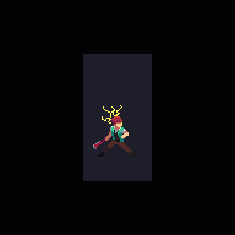

# Area light



`Voltage.DeferredLighting.AreaLight` lights a rectangle with light from one direction. Inside the rectangle it behaves like a [directional light](directional-light.md); outside it nothing is lit. Use it for light through a window, the glow of a screen or sign, a lit doorway or a pool of light on a stage.

## Requirements

Turn on **Deferred lighting** in **Project > Settings > Rendering Layers** and set the component's `RenderLayer` to **Lighting**. See the [Lighting Overview](../lighting.md).

## Settings

| Setting | Default | Purpose |
| --- | --- | --- |
| `RectangleWidth`, `RectangleHeight` | 200, 200 | Size of the lit rectangle, centred on the entity and scaled by the entity's scale. |
| `Direction` | (500, 500, 50) | Direction the light travels, as X, Y and Z. |
| `Intensity` | 12 | Brightness. |
| `Color` | white | Light colour. |
| `LocalOffset` | (0, 0) | Offset of the rectangle from the entity. |

`Direction` follows the same rules as the directional light: positive X travels right, positive Y travels down, and a negative Z lights surfaces that face the viewer. The default, with a small positive Z, mostly lights edges facing up and left, which suits a rim of light from a high window. For an evenly lit rectangle, use a negative Z such as `(0, 20, -60)` with an `Intensity` around 3 to 4.

## In code

```csharp
using Voltage.DeferredLighting;

var window = Entity.AddComponent(new AreaLight(width: 48, height: 96));
window.Direction = new Vector3(30, 40, -50);
window.Intensity = 3f;
window.Color = new Color(190, 220, 255);
window.SetRenderLayer(RenderLayer.GetRenderLayer("Lighting"));
```

The edges of the rectangle are hard. For soft, room-shaped fill, use a [Room Light](room-light.md); for light shaped by the pixels of a window, use a [Projected Light](projected-light.md).
