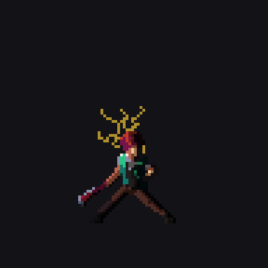

# Directional light

`Voltage.DeferredLighting.DirLight` lights everything on screen from one direction, like the sun or the moon. It has no position or range and is never culled. It is the only light type that adds specular highlights.

## Requirements

Turn on **Deferred lighting** in **Project > Settings > Rendering Layers** and set the component's `RenderLayer` to **Lighting**. See the [Lighting Overview](../lighting.md).

## Settings

| Setting | Default | Purpose |
| --- | --- | --- |
| `Direction` | (50, 20, 100) | The direction the light travels, as X, Y and Z. Only its direction matters, not its length. |
| `Color` | white | Light colour. There is no separate intensity: a brighter colour is a brighter light. |
| `SpecularIntensity` | 0.5 | Strength of the highlight, 0 to 1. |
| `SpecularPower` | 2 | Tightness of the highlight; higher values give a smaller, sharper glint. |

Positive X travels right and positive Y travels down the screen, so `(1, 0, z)` lights surfaces that face left. The Z component decides how much reaches surfaces that face the viewer. A negative Z shines into the screen and lights them fully; a positive Z, as in the default, only lights edges whose normals point back towards the light, which reads as rim light. Flat areas without a normal map count as facing the viewer. For a sun over the whole scene, start from something like `(40, 30, -60)`.

## Tips

- One directional light per scene is usually enough. Combine it with a low ambient colour for night scenes, or a warm colour at a low angle for sunsets.
- Change `Direction` over time for a day cycle, or `Color` for weather and mood.
- Use point and spot lights for local sources; a directional light cannot be confined to an area. For a lit rectangle with the same kind of shading, use an [Area Light](area-light.md).
