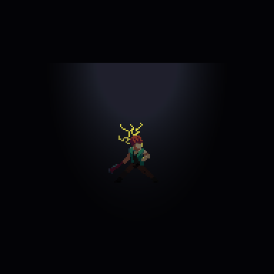

# Fluorescent light

`Voltage.DeferredLighting.FluorescentLight` emits from a straight bar, like a ceiling tube, toward the entity's local positive Y (down, unrotated). It shades receivers through their normal maps and casts nothing upward.

## Requirements

- Turn on **Deferred lighting** in **Project > Settings > Rendering Layers**, then reload the scene. With it on, every scene that does not set up its own renderers gets a `DeferredLightingRenderer`, which draws the lights on the **Lighting** render layer.
- Set the component's `RenderLayer` to **Lighting**. Only lights belong on that layer.

## Placement

Rotate the entity to aim the bar. Parent transforms, negative scale and non-uniform scale transform the bar and its footprint too; a negative Y scale flips the side it shines toward. A zero or non-finite scale emits nothing.

To edit it in the game view, select the entity in Edit mode and switch to **Resize Bounds** (4 or T). Side handles change `SourceLength` and top or bottom handles change `Range`; the entity and the bar's origin stay put, the handles follow the light's rotation, and the edit is undoable. Debug rendering draws the bar and the edge of its footprint.

## Settings

| Setting | Default | Purpose |
| --- | --- | --- |
| `SourceLength` | 96 | Bar length in local pixels |
| `Range` | 140 | Reach away from the bar in local pixels |
| `Spread` | 0.2 | Extra half-width per pixel of reach, 0 to 2 |
| `EdgeSoftness` | 8 | Feather width at the footprint edge, in local pixels |
| `Falloff` | 1.5 | Exponent of the fade toward the edge, 0.1 to 8 |
| `ZPosition` | 48 | Height above the receivers for normal shading |
| `Color` / `Intensity` | white / 0.5 | Hue and brightness; intensity 0 to 8 |
| `LocalOffset` | (0, 0) | Bar position relative to the entity |
| `FlickerDepth` | 0 | Deepest dip as a fraction of intensity, 0 to 0.5; 0 turns flicker off |
| `FlickerDuration` | 1.5 | Length of each flicker burst in seconds, at most half the interval |
| `FlickerInterval` | 20 | Seconds between the starts of two bursts, 2 to 120 |
| `FlickerPhase` | 0 | Offset into the cycle in seconds, to desynchronise several lamps |

## Footprint

The lit area is a feathered half ellipse below the bar. Its half-width is `SourceLength / 2 + Range * Spread + EdgeSoftness` and its depth is `Range`. Brightness fades continuously toward the curved edge. Each receiving pixel takes its light direction from the nearest point on the bar. This is an art-directed 2D approximation: there are no shadows or visible beams. Pair it with a [Room Light](room-light.md) for the bounded fill around it.

## Flicker

Each burst plays three short, uneven dips in brightness, then the lamp stays steady until the next burst. The timing, width and depth of the dips vary from burst to burst but repeat exactly, so a scene looks the same every run. Flicker only ever dims: it never brightens past `Intensity` or switches the lamp fully off.

The flicker clock runs only in Play mode while the light is enabled. It ignores time scale, stops while the game is paused and resets when the component is removed. `FlickerMultiplier` exposes the current factor, so a lamp sprite or emissive material can dim in step with the light. A [Room Light](room-light.md) can follow the same lamp through its `SourceLight`, but that field takes a point or spot light, not a fluorescent light.
