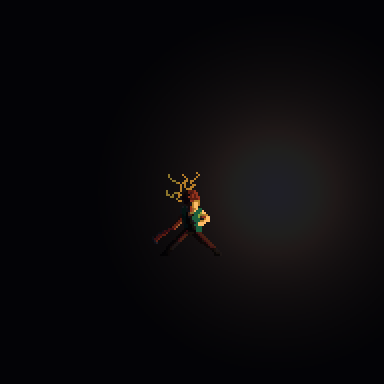

# Point light



`Voltage.DeferredLighting.PointLight` lights a circle around the entity. It is the everyday light: lamps, torches, muzzle flashes, sparks and pickups. Surfaces with normal maps are shaded by the direction to the light, so the side of a sprite that faces the lamp brightens.

## Requirements

Turn on **Deferred lighting** in **Project > Settings > Rendering Layers** and set the component's `RenderLayer` to **Lighting**. See the [Lighting Overview](../lighting.md).

## Settings

| Setting | Default | Purpose |
| --- | --- | --- |
| `Radius` | 400 | How far the light reaches, in pixels. Multiplied by the entity's X scale. |
| `Intensity` | 3 | Brightness. |
| `ZPosition` | 150 | Height of the light above the scene. |
| `Color` | white | Light colour. |
| `LocalOffset` | (0, 0) | Offset from the entity's position. |

Brightness falls off linearly with the 3D distance from the light, including its height. Keep `ZPosition` well below `Radius`: a light whose height approaches its radius barely reaches the ground. A low light skims across sprites and brings out their normal maps; a high one lights them more evenly.

## In code

```csharp
using Voltage.DeferredLighting;

var lamp = Entity.AddComponent(new PointLight(new Color(255, 200, 140), radius: 160));
lamp.Intensity = 2.5f;
lamp.ZPosition = 40;
lamp.SetRenderLayer(RenderLayer.GetRenderLayer("Lighting"));
```

Animate `Intensity` or `Color` from code or with a [tween](../../utilities/tweening.md) for flicker and pulses. A point light can also drive a [Room Light](room-light.md) through its `SourceLight`, so the room fill dims with the lamp.
