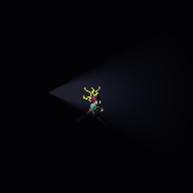

# Spot light



`Voltage.DeferredLighting.SpotLight` is a [point light](point-light.md) restricted to a cone. The cone points along the entity's rotation: 0 points right, and rotating the entity aims it. Use it for flashlights, stage lights, security lights and headlights.

## Requirements

Turn on **Deferred lighting** in **Project > Settings > Rendering Layers** and set the component's `RenderLayer` to **Lighting**. See the [Lighting Overview](../lighting.md).

## Settings

Everything from the point light (`Radius`, `Intensity`, `ZPosition`, `Color`, `LocalOffset`) plus:

| Setting | Default | Purpose |
| --- | --- | --- |
| `ConeAngle` | 90 | Full width of the cone, in degrees. Light fades from the centre line to the edge of the cone. |

`Direction` reports the unit vector the cone points along. It is read-only; aim the light by rotating its entity.

## In code

```csharp
using Voltage.DeferredLighting;

var torch = Entity.AddComponent(new SpotLight(Color.White));
torch.SetConeAngle(40).SetRadius(220).SetIntensity(3);
torch.SetDirection(Core.Scene.Camera.MouseToWorldPoint() - Entity.Position);   // rotates the entity
```

`SetDirection` turns the entity to face a direction, which suits a flashlight that follows the mouse or a turret's aim. Parent the light to a character to have it follow and turn with them.
