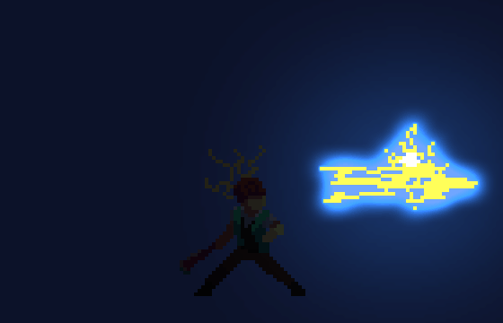

# Sprite light



`Voltage.DeferredLighting.SpriteLight` turns a sprite into a light source. It takes the shape of a sprite renderer's current frame, blurs it into a soft halo and adds that to the light buffer, so the area around the sprite brightens in the sprite's own shape. Because it follows the frame, an animated spark, flame, neon sign or spell lights its surroundings exactly as it moves.

## Requirements

Turn on **Deferred lighting** in **Project > Settings > Rendering Layers** and set the component's `RenderLayer` to **Lighting**. See the [Lighting Overview](../lighting.md).

## Setup

1. Add `SpriteLight` to an entity, usually the one with the glowing sprite.
2. Assign `Source`: the `SpriteRenderer` or `SpriteAnimator` to follow. The light uses its position, origin, flip, rotation and scale.
3. Set `Color`, `Intensity` and `Radius`.

Without a `Source`, or while the source or its entity is disabled, the light emits nothing. The source's colour alpha scales the light, so fading the sprite out fades its glow with it.

## Settings

| Setting | Default | Purpose |
| --- | --- | --- |
| `Source` | none | The sprite renderer whose frames shape the light. |
| `Radius` | 24 | How far the glow spreads beyond the silhouette, in pixels, 1 to 128. |
| `Intensity` | 1.4 | Brightness, 0 to 8. |
| `GlowFalloff` | 1 | Tightens the faint outer halo while keeping the silhouette bright, 1 to 8. |
| `UseSourceSprite` | on | Use each frame's own alpha as the emitting shape. |
| `Color` | white | Light colour. |

## Masks

By default every opaque pixel of the frame emits. To make only part of a sprite glow, such as a lantern's flame but not its frame, give each animation frame a mask with `SetFrameMask(frame, mask)`: the mask's alpha becomes the emitting shape for that frame. With `UseSourceSprite` off, frames without a mask emit nothing.

```csharp
var glow = Entity.AddComponent(new SpriteLight { Source = GetComponent<SpriteAnimator>(), Radius = 32, Intensity = 2f });
glow.Color = new Color(120, 220, 255);
glow.SetRenderLayer(RenderLayer.GetRenderLayer("Lighting"));
```

The halo for each frame is computed once and cached, so changing `Radius` or `GlowFalloff` rebuilds the cache. Keep radii modest on large sprites.

A sprite light lights its surroundings. To make the sprite itself look self-lit, paint a `Glow-` layer for it; see [Animated Normal Maps](../animated-normal-maps.md#glow).
