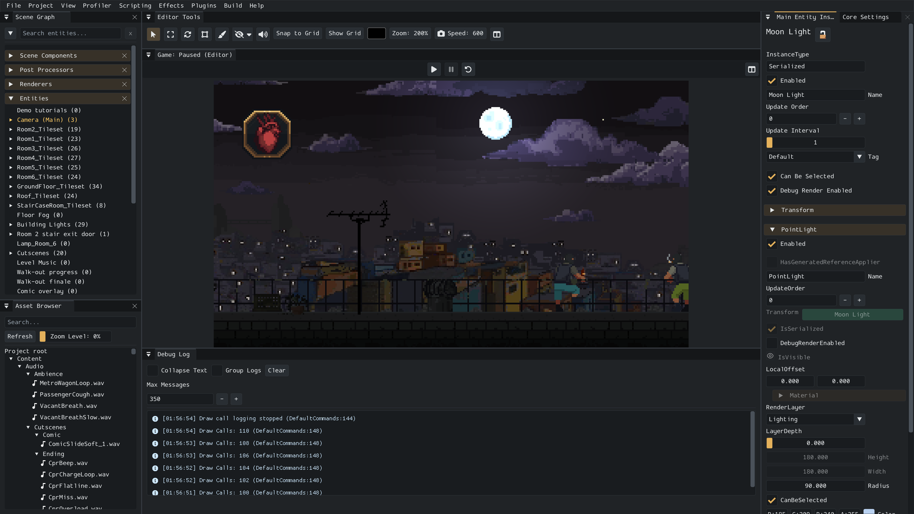
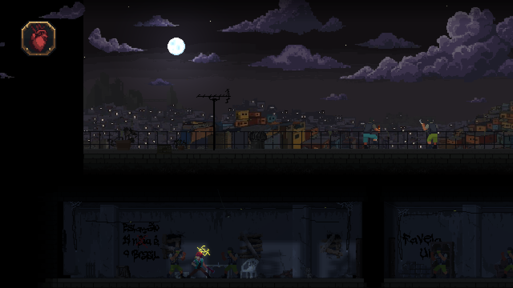

# Introduction

Voltage is a C# engine and live editor for 2D pixel art games on Windows, macOS and Linux. Paint tiles, arrange scenes, tune lights and test gameplay in one dockable workspace. Your game stays a separate C# project: its scripts reload on save, and the editor's Build window publishes it as a self-contained desktop executable.

The whole workspace in one window, here editing the rooftop of the game Jolt. The Scene Graph and Asset Browser are on the left, the live Game view sits in the centre with Editor Tools above it, the Inspector on the right shows the selected moon light's components, and the Debug Log runs along the bottom. Every panel docks anywhere; see [Main Windows](editor/windows.md).

## Pixel art workflow

Import Aseprite layers, tags and frame timing, paint layered tilemaps, and sync source changes from the Tile Palette or Tileset Editor. Data assets and prefabs keep gameplay tuning editable alongside the art. Animated normal maps, room lights and projected lights with transparent masks light the scene without repainting the sprites.

Desktop targets are Windows, Linux and macOS on Intel and Apple Silicon. The editor and runtime use MonoGame DesktopGL. NativeAOT publishing needs the platform's native toolchain; see [Installation](getting-started/installation.md).

## Working with agents

The [Editor Gateway, CLI and MCP server](gateway/README.md) let scripts and AI agents inspect and edit the same scenes and assets you see in the editor, with every edit in the undo history. The [Aseprite bridge](editor/aseprite.md) adds sprite creation, pixel edits, palettes and animation tools.

## How a game is structured

A game is a set of **scenes** containing **entities** containing **components**. This is a component model in the style of Unity's MonoBehaviour, not a strict ECS.

- `Entity` is a sealed container with a `Transform` (position, rotation, scale and a parent/child hierarchy). You never subclass it.
- `Component` holds data and behaviour. Game code is written as components.
- `SceneComponent` attaches to the scene rather than to an entity, for scene-wide managers.

Each entity has an instance type: `NonSerialized` (created from code, never saved), `Serialized` (the default for editor entities), `SerializedPrefab` (an instance of a `.vprefab`) or `SceneRequired` (always present and cannot be deleted, used for the main camera).

Physics in the engine is arcade collision: `BoxCollider`, `CircleCollider` and `PolygonCollider`, the `Mover` component and `ArcadeRigidbody`. Full rigid-body physics is available as the Farseer plugin (`voltage.farseer`), installed from **Plugins > Plugin Manager > Browse Plugins**.

## Engine and editor

| Project | Output | Role |
|---|---|---|
| `Voltage.Engine` | `Voltage.dll` | Runtime: `Core`, `Scene`, `Entity`, `Component`, content loading, rendering, collision, audio, the runtime gateway. Builds with or without the `EDITOR` symbol. |
| `Voltage.Persistence` | `Voltage.Persistence.dll` | The JSON serializer used for scenes, prefabs and assets. |
| `Voltage.SourceGenerators` | Roslyn generator | Emits reflection-free serialization for every `partial` component, scene component and data asset. |
| `Voltage.Editor` | `Voltage.Editor` executable | ImGui editor: projects, assets, script compilation and hot reload, game builds, the Editor Gateway. References the engine built with `EDITOR`. |
| `Voltage.Cli` | `voltage` | Command-line and MCP client for the Editor Gateway. |

Your game project references the engine assemblies (copied into its `EngineLibs/` folder) but never the editor. In the editor, scripts compile in memory and load as a `DynamicScripts` assembly. A published game compiles the same scripts directly into its executable.

The generated `Program.cs` defines `<Project>Game : Core`, loads `ProjectSettings.json`, creates the default bitmap font from `Content/Voltage/Fonts/VoltageDefaultBMFont.fnt`, and loads `settings.InitialScene`.

## Tech stack

- **Runtime:** C# on .NET 8 (`net8.0`).
- **Windowing and graphics:** MonoGame.Framework.DesktopGL 3.8.5.1 (SDL2 and OpenGL).
- **Editor UI:** ImGui.NET 1.91.6.1.
- **Publishing:** .NET NativeAOT with trimming, or a faster self-contained build without AOT.
- **Serialization:** `Voltage.Persistence` JSON, with generated readers so published builds deserialize scenes without reflection.
- **Source formats:** `.png`, `.aseprite`/`.ase`, `.tmx`/`.tsx` (Tiled), `.wav`, `.ogg`, `.mp3`, `.fnt` (BMFont), `.fx` shaders.
- **Native formats:** `.vscene`, `.vprefab`, `.vtileset`, `.vtimeline`, `.vasset`. See [Asset File Formats](assets/README.md).

## Compared with other engines

| Concept | Voltage | Unity | Godot |
|---|---|---|---|
| Script attachment | `Component` on `Entity` | `MonoBehaviour` on `GameObject` | Script on a `Node` |
| Scene-wide logic | `SceneComponent` | `MonoBehaviour` on a manager object | Autoload singleton |
| Shared data | `DataAsset` (`.vasset`) | `ScriptableObject` | `Resource` |
| Scene file | `.vscene` | `.unity` | `.tscn` |
| Prefab file | `.vprefab` | `.prefab` | `.tscn` (instanced) |
| Asset identity | `.meta` GUID sidecar, shipped in `Data/assets.manifest` | `.meta` GUID sidecar | `uid://` |
| Game loop entry | `<Project>Game : Core` | Hidden by the engine | Hidden by the engine |

## Limitations

- Prefab overrides work per component. Changing any field of a component on an instance overrides that whole component, so later edits to the same component in the prefab no longer reach that instance. Components added or removed on an instance are tracked. Field-level overrides are not supported.
- An instance's position, rotation and scale belong to the instance and are saved in the scene; they are never inherited from the prefab. At runtime, `Scene.LoadPrefab(path, position)` places a new instance.
- Asset references resolve by GUID first, then by stored path, in the editor and in published builds. A file renamed or moved while the editor is closed must take its `.meta` file with it, or references to it fall back to the old path.
