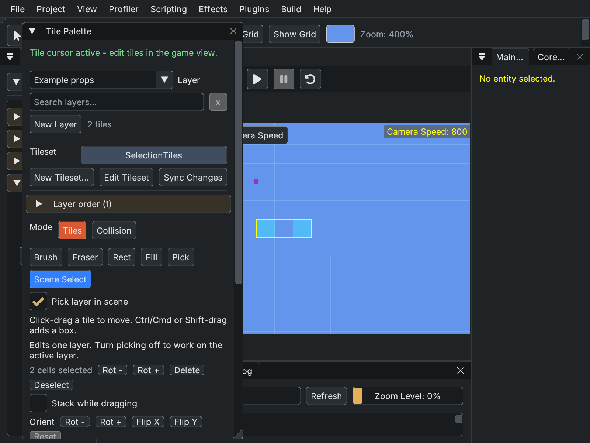
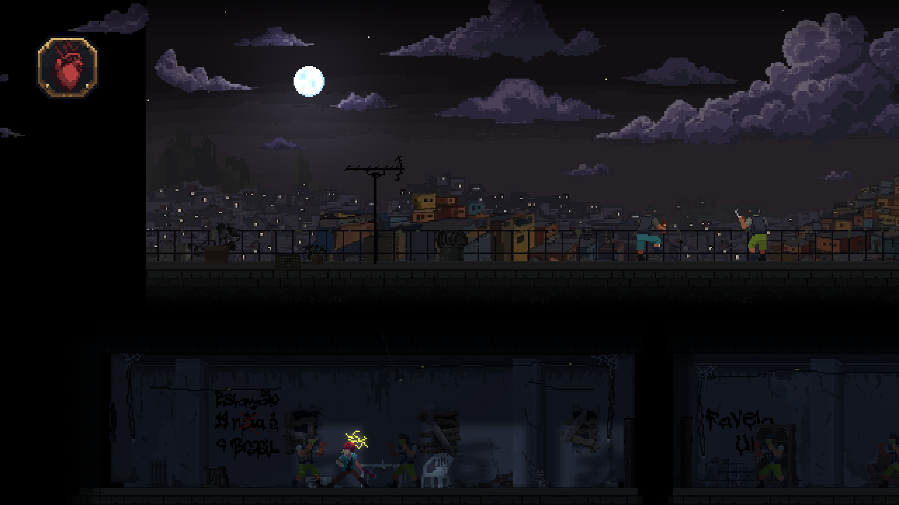

# Introduction

Voltage is a C# engine and live editor for 2D pixel art games on Windows, macOS and Linux. Paint tiles, arrange scenes, tune lights and test gameplay in one dockable workspace. Your game remains a separate C# project, with scripts that reload on save and an editor Build window for self-contained desktop publishing.

The current editor uses Studio Graphite with dockable tool windows. This example shows [Scene Select](editor/tile-selection.md), which edits placed cells separately from the palette's source stamp.

## Pixel art workflow

Import Aseprite layers, tags and frame timing, paint layered tilemaps and sync source changes from the Tile Palette or Tileset Editor. Saved data assets and prefabs keep gameplay tuning editable alongside the art. Animated normal maps, room lights and transparent-mask projected lights add lighting while retaining the sprite artwork.

Desktop targets include Windows, Linux and Intel/Apple Silicon macOS. The editor and runtime use MonoGame DesktopGL; NativeAOT publishing requires the platform's native toolchain. See [installation](getting-started/installation.md) for prerequisites.

## Working with agents

The local [Editor Gateway, CLI and MCP server](gateway/README.md) let scripts and AI agents inspect and author the same scenes and assets you see in the editor. The [Aseprite bridge](editor/aseprite.md) also exposes sprite creation, pixel edits, palettes and animation tools, with previews and undo. External image-generation tools can complement this workflow; Voltage's bridge handles editable sprite assets and project import.

## What Voltage Is

Voltage is a **standalone editor + runtime engine** for 2D pixel-art games written in C#. The editor is a single executable; game code lives in a separate C# project that the editor compiles, hot-reloads, and eventually publishes.

At runtime the world is structured as **Scenes containing Entities containing Components** — a traditional component-based model similar to Unity's MonoBehaviour system rather than a strict ECS. Entities carry a `Transform` (position, rotation, scale, parent/child hierarchy). Components hold data and behavior. `SceneComponent`s attach to the scene itself rather than to any entity and are useful for scene-wide managers.

## Engine vs Editor Split

| Layer | Project | Role |
|---|---|---|
| `Voltage.Engine` | `Voltage.Engine.dll` | Core runtime: `Core`, `Scene`, `Entity`, `Component`, content loading, rendering, physics, audio. Compiles with or without the `EDITOR` preprocessor symbol. |
| `Voltage.Editor` | `Voltage.Editor.exe` | ImGui editor shell, project/asset management, hot-reload, serialization manager, game builder. Depends on `Voltage.Engine` with `EDITOR` defined. |
| `Voltage.SourceGenerators` | Roslyn analyzer | Generates AOT-safe serialization code for every `partial Component` and `partial SceneComponent` subclass. |

Game code (your scripts) lives in a separate game project that references `Voltage.Engine` but not `Voltage.Editor`. The editor compiles your scripts into a `DynamicScripts` assembly and loads it at runtime; a published game includes only your compiled scripts + the engine.

## Tech Stack

- **Language / runtime:** C# / .NET (modern)
- **Windowing / graphics:** MonoGame.Framework.DesktopGL 3.8.5.1 (SDL2 backend, OpenGL renderer)
- **Editor UI:** ImGui.NET (immediate-mode GUI)
- **Publishing:** .NET NativeAOT + trimming
- **Serialization:** Custom `Voltage.Persistence.Json` with AOT-safe deserializers; no reflection at runtime in published builds
- **Asset formats:** `.png`, `.ase`/`.aseprite`, `.tmx` (Tiled), `.wav`, `.ogg` (via MonoGame)

## Comparison to Other Engines

| Concept | Voltage | Unity analog | Godot analog |
|---|---|---|---|
| Script attachment | `Component` on `Entity` | `MonoBehaviour` on `GameObject` | `Node` script |
| Scene-wide logic | `SceneComponent` | `MonoBehaviour` on scene root | `AutoLoad` singleton |
| Scene file | `.vscene` | `.unity` | `.tscn` |
| Prefab file | `.vprefab` | `.prefab` | `.tscn` (instanced) |
| Asset GUID | `.meta` sidecar (editor-only) | `.meta` sidecar | `uid://` embedded |
| Game loop entry | `Core : Game` | Hidden by engine | Hidden by engine |

## Notable Limitations

- The `.meta` / GUID asset-reference system is **editor-time only**. Published games resolve assets by file path.
- Prefab overrides are at the **component level** only (the entire component's data is replaced). Field-level property overrides (like Unity's) are not supported.
- `Entity.Transform` position/rotation/scale are **not** part of prefab delta data; position is supplied at instantiation time via `Scene.LoadPrefab(path, position)`.
- There is no visual prefab editing mode; prefabs are authored by saving an entity as a prefab from the Scene Graph.
