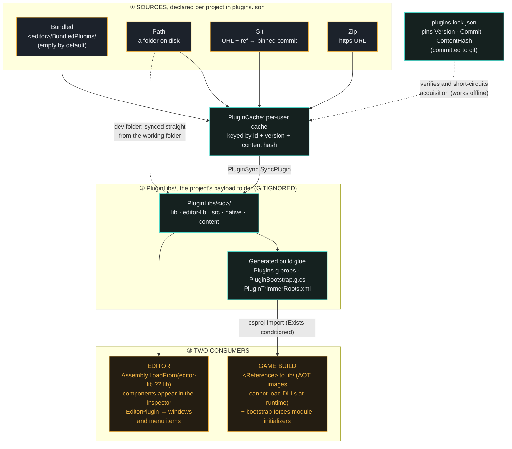
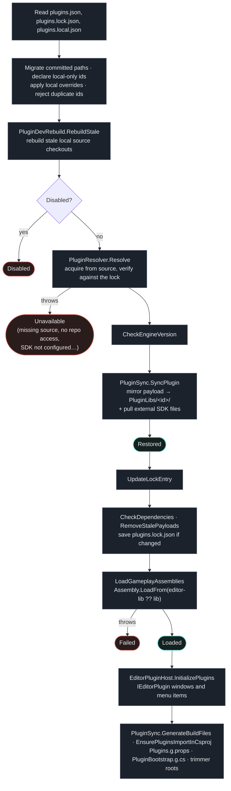

# Plugins

A **plugin** is a folder with a `plugin.json` manifest at its root. It can contribute gameplay code (prebuilt DLLs or plain `.cs` sources), native libraries, content and editor tooling. The editor ships no plugins of its own: the Farseer rigid-body physics plugin (`voltage.farseer`), for example, lives in its own repository and installs from **Plugins > Plugin Manager > Browse Plugins**.

## 1. How a plugin reaches the editor and the game

Plugins are **acquired** from a source, **cached** per user, **synced** into the project, and then consumed by two different hosts: the editor, which loads DLLs at runtime, and the game build, which references them statically so they survive NativeAOT.



**The key asymmetry:** the editor can `Assembly.LoadFrom` a DLL at runtime; a published NativeAOT game cannot. So the game gets plugins as static MSBuild references compiled into the image, plus a generated bootstrap that forces each plugin's `[ModuleInitializer]` registrations to run.

## 2. Anatomy of a plugin package

Everything is optional except `plugin.json`.

```
my-plugin/
├── plugin.json              # the manifest (required)
├── lib/                     # gameplay DLLs: net8.0, built WITHOUT the EDITOR symbol
├── editor-lib/              # optional EDITOR-flavoured twins of lib/ (engine-style modules only)
├── editor/                  # editor-plugin DLLs: reference Voltage.Editor.dll, implement IEditorPlugin
├── src/                     # source-form gameplay code, compiled together with the game's Scripts/
├── native/<rid>/            # per-RID native libraries (win-x64, osx-arm64, …)
└── content/                 # runtime content copied into the game build's Content folder
```

Ship **either** `lib/` (prebuilt) **or** `src/` (source form). Source form is simpler: the `.cs` files compile into the game, and their generated module initializers run natively, so they need no bootstrap entry. Prebuilt suits closed-source or slow-to-compile code.

## 3. `plugin.json` reference

All keys are PascalCase.

### Top level

| Field | Type | Notes |
| --- | --- | --- |
| `SchemaVersion` | int | Must be `1`. |
| `Id` | string | **Required.** Stable reverse-domain id (`voltage.farseer`, `com.studio.fmod`). It is the plugin's identity everywhere; never change it. |
| `Name` | string | Display name in the Plugin Manager. |
| `Version` | string | **Required.** Semver (`1.2.0`). |
| `Description` | string | Shown in the Plugin Manager. |
| `Author` | string | Optional vendor name. |
| `Kinds` | string[] | **Required.** `"gameplay"` and/or `"editor"`. Decides which sections below must be present. |
| `EngineVersion` | string | Supported engine range: `"*"` (the default), `">=0.1.0"`, `">=0.1.0 <0.2.0"`. A mismatch **warns only**; the plugin still loads. |
| `EditorPluginApiVersion` | int | Hard-checked for editor plugins: a mismatch means `Failed`. The current API is `2` and the field defaults to `1`, so an editor plugin must declare it. Ignored for gameplay-only plugins. |
| `Dependencies` | object[] | `{ "Id": "...", "Version": ">=1.0.0" }`, checked against the other plugins in the project. **Not installed automatically:** a dependency missing from `plugins.json`, disabled, unavailable or out of range makes this plugin `Unavailable`. |
| `Gameplay` | object | Required when `Kinds` contains `"gameplay"`. |
| `Editor` | object | Required when `Kinds` contains `"editor"`. |
| `ExternalSdks` | object[] | SDKs the user installs themselves (see §7). |

### `Gameplay`

| Field | Type | Notes |
| --- | --- | --- |
| `ManagedAssemblies` | string[] | Package-relative DLLs shipped into the game (runtime flavour, no `EDITOR` symbol). |
| `EditorManagedAssemblies` | string[] | Optional `EDITOR`-flavoured twins with the same assembly names. The editor loads these instead when present. Only modules with `#if EDITOR` code need them. |
| `SourceRoots` | string[] | Folders whose `.cs` files compile together with the game's `Scripts/`. |
| `RootTypes` | string[] | One namespace-qualified public type per managed assembly. The bootstrap uses it to root the assembly for AOT and force its module initializers. **Auto-detected when omitted.** |
| `TrimmerRootAssemblies` | string[] | Assembly simple names preserved wholesale from trimming. Defaults to the names in `ManagedAssemblies`. |
| `Natives` | object[] | `{ "Rid": "win-x64", "Files": ["native/win-x64/*.dll"] }`. The layout convention is `native/<rid>/`. |
| `Content` | string[] | Copied into the game build's `Content/` folder. Only the **first path segment** is honoured: `"content/**"` copies the whole `content/` tree, keeping paths relative to it. The rest of the glob is ignored, so it cannot filter. |

### `Editor`

| Field | Type | Notes |
| --- | --- | --- |
| `Assemblies` | string[] | Editor-plugin DLLs containing `IEditorPlugin` implementations. |

### Example: a prebuilt gameplay plugin

```json
{
	"SchemaVersion": 1,
	"Id": "com.studio.physics",
	"Name": "Studio Physics",
	"Version": "1.0.0",
	"Description": "Rigid bodies and joints.",
	"Kinds": ["gameplay"],
	"EngineVersion": ">=0.2.0",
	"Gameplay": {
		"ManagedAssemblies": ["lib/Studio.Physics.dll"],
		"EditorManagedAssemblies": ["editor-lib/Studio.Physics.dll"],
		"RootTypes": ["Studio.Physics.RigidBody"]
	}
}
```

The manifest is validated on load (`PluginManifest.Validate`). Required fields, kinds and their sections are checked, and every file listed in `ManagedAssemblies`, `EditorManagedAssemblies` and `Editor.Assemblies`, and every `SourceRoots` folder, must exist in the package; otherwise the plugin goes `Unavailable` with a message saying why. Files an external SDK pull is expected to produce are exempt.

## 4. The project files

| File | Committed? | Written by | Purpose |
| --- | --- | --- | --- |
| `plugins.json` | **yes** | you or the Plugin Manager | Which plugins the project uses, and from where. |
| `plugins.lock.json` | **yes** | the editor | Exactly what was resolved: version, commit, content hash. |
| `plugins.local.json` | **no, gitignored** | the editor | Which plugins this machine resolves from a folder of its own (`Id` and `Path` only). |
| `PluginLibs/` | **no, gitignored** | the editor | The synced payloads and generated build glue. Regenerated on project open. |

### Local folders stay out of the project

A path only means something on the machine that wrote it, so committing one breaks every teammate's restore. The two halves are kept apart:

- **`plugins.json`** carries the plugin's `Id` and a source a teammate can actually fetch: git, zip, bundled, or a path *inside the repository* (a vendored plugin travels with the checkout).
- **`plugins.local.json`** carries your folder, and never leaves your machine.

The editor writes the split for you. Adding a plugin from a folder records the path locally and the `Id` in `plugins.json` with no source, so a teammate opening the project is told that it uses, say, `voltage.dialoguemaker` and nobody has published it, rather than seeing an empty plugin list and a scene full of missing components. An older project with an absolute path in `plugins.json` migrates on open (the path moves to `plugins.local.json` when the folder exists on this machine), and the `.gitignore` rule is added at the same time.

This is the split npm draws between a dependency and `npm link`. It accepts the same trade: two people can run different code for one plugin id with nothing in git recording it. The Plugin Manager marks a plugin resolved from a path **LOCAL**, and **LOCAL ONLY** when `plugins.json` declares it with no source a teammate could fetch.

To make a local plugin shareable, either **publish** it (**Publish New Version**, then **Declare for the team**, which points the entry at the published release; see §11) or **vendor** it (**Vendor** copies it to `Plugins/<id>/` and declares it by relative path).

`plugins.json`:

```json
{
	"SchemaVersion": 1,
	"Plugins": [
		{
			"Id": "voltage.farseer",
			"Source": { "Bundled": false, "Git": "https://github.com/<owner>/<repo>.git", "Ref": "v1.2.1", "Zip": null, "Path": null },
			"Dev": false,
			"Disabled": false
		}
	]
}
```

Exactly **one** of `Bundled`, `Git`, `Zip` or `Path` is set, except for a local-only declaration, which has none.

> ### `PluginLibs/` must be gitignored
>
> It holds locally built DLLs, generated MSBuild glue and, for external-SDK plugins, files under NDA that must never enter a repository. It is fully reproducible from `plugins.json` and `plugins.lock.json`.
>
> New projects get the rule automatically (`ProjectStructureGenerator.CreateGitIgnoreFile`). To fix an older project where it is tracked:
>
> ```sh
> git rm -r --cached PluginLibs
> printf '\nPluginLibs/\n' >> .gitignore
> ```
>
> The csproj's `Import` of `Plugins.g.props` is `Exists`-conditioned, so a fresh clone without `PluginLibs/` still builds, but **open the project in the editor once** before building the game from an IDE so the glue is regenerated.

## 5. What happens when a project opens

`PluginManager.RestoreForProject` runs this sequence. Each plugin is independent: one bad plugin never stops the project from opening.



**States** (`PluginState`): `Disabled`, `Restored` (payload synced), `Loaded` (assemblies loaded in the editor), `Unavailable` (could not be acquired or verified), `Failed` (acquired, but loading threw).

A game build refuses to start while any plugin is `Unavailable` or `Failed` (`PluginSync.SyncForBuild`): shipping a game without a plugin its scenes depend on is worse than a failed build.

> **Plugin assemblies never unload.** They load into the default `AssemblyLoadContext`, not a collectible one. Enabling, disabling, updating or removing a plugin therefore takes effect after the project is reopened or the editor restarts; **Reload Plugins** in the Plugin Manager relaunches the editor. Source-form dev plugins are the exception for source changes, which hot-reload (see §9).

Removing a plugin does not damage your scenes: entities keep its component data as missing-component entries, and adding the plugin back restores them. Nothing is dropped on save.

## 6. The four sources

| Source | Acquired from | Pinned by | Cached? |
| --- | --- | --- | --- |
| **Bundled** | `<editor>/BundledPlugins/<folder>/` | the editor-provided `Version` | no, read in place |
| **Path** | a folder on disk | `ContentHash`, except for dev folders and source checkouts | yes, except dev folders |
| **Git** | `git` URL + `Ref` (tag, branch or SHA) | resolved `Commit` + `ContentHash` | yes |
| **Zip** | https URL | `ContentHash` | yes |

**Bundled** remains a supported source for offline or enterprise distribution, but the editor ships nothing in `BundledPlugins/`. An old `"Bundled": true` entry for a plugin that moved to its own repository goes `Unavailable` with a message naming its Git source.

Pinnable payloads are hashed and copied into a per-user cache at `<editor cache root>/PluginCache/<id>/<version>+<first 8 hex of hash>/` (on Windows under `%LOCALAPPDATA%\VoltageEngine\Editor`), shared across projects and written once. On the next open, if the lock pins that exact payload and the cache holds it, resolution needs **no network access**. A hash that does not match the lock is a **hard error**: the payload changed underneath a pin, which is exactly what a lockfile exists to catch.

The hash is SHA-256 over each file's lower-cased relative path and raw bytes, files sorted ordinally, with `.git/` and `.DS_Store` excluded, so the same payload fetched by git and by zip hashes identically.

**Git uses your own `git` CLI** on `PATH`, with your existing credentials (SSH agent, credential helper). The editor never handles a token, which is what lets a private or NDA plugin repository work with no credential setup. The `Ref` is resolved to a full commit SHA and that SHA goes in the lock, so a force-pushed tag can never hand teammates different code.

**Zip** accepts `plugin.json` at the archive root or inside a single top-level folder (GitHub's "Download ZIP" shape).

**Source checkouts are not content-pinned.** A plugin repository holds `plugin.json` next to its sources, with `lib/`, `editor-lib/` and `editor/` gitignored because CI builds them. Built assemblies embed machine-specific paths, so their hash differs per machine and recording it would make the lock churn. A Path source checkout is therefore unpinned, a Git source that has to be built from source is cached by commit and unpinned, and Bundled payloads pin on the editor's `Version` (`ResolvedPlugin.IsPinnable = false`).

### Building a source checkout

When you add a folder that is a source checkout (a folder with a project exposing the `PackagePlugin` target) and its declared assemblies are missing, the editor builds it first with `PluginSourceBuild`: `dotnet restore` on each project at the plugin root, then `dotnet msbuild <project> -t:PackagePlugin`, with `VoltageEnginePath` and `VoltageEditorPath` pointing at the running editor's own folder. A plugin is therefore never built against a different Voltage from the one about to load it. The first build takes a few minutes; progress and errors appear in the Plugin Manager's messages. If the folder has no project exposing `PackagePlugin`, the error says the folder is a source checkout and what to do, rather than reporting a missing file.

After that, checkouts are rebuilt automatically at two moments:

- **At project open**, before anything is resolved or loaded, `PluginDevRebuild` rebuilds each local checkout whose declared assemblies are missing, whose sources are newer than its build, or that is older than the editor's `Voltage.dll` or `Voltage.Editor.dll`. Up-to-date checkouts cost a directory walk. This has to happen before loading, because assemblies loaded with `Assembly.LoadFrom` cannot be swapped afterwards.
- **After each editor build**, the `RebuildDevPlugins` target runs `PackagePlugin` for every checkout listed in `Voltage.Editor/dev-plugins.txt` (one folder per line, `#` comments, gitignored) or passed as `-p:VoltageDevPlugins="C:\src\A;C:\src\B"`. Skip it for one build with `-p:VoltageSkipDevPlugins=true`. A failed or missing plugin is logged and never fails the editor build.

Editing a plugin while the editor is running still needs a restart; that is the same unloading limitation, not an oversight.

## 7. External SDKs (FMOD, console SDKs, anything under NDA)

Some SDKs cannot be redistributed. A plugin declares them, and the files are pulled from the user's own install at sync time; they never enter the package, the cache or git.

```json
"ExternalSdks": [
	{
		"Id": "fmod",
		"DisplayName": "FMOD Engine",
		"EnvVar": "FMOD_SDK",
		"Required": true,
		"Pulls": [
			{ "From": "api/core/lib/x64/fmod.dll", "To": "native/win-x64/" }
		]
	}
]
```

The SDK path comes from the per-user setting `PluginSdk_<Id>`, set in the Plugin Manager's **External SDKs** section (**Browse**, **Save Path**), or falls back to `EnvVar`. A `Required` SDK that is not configured makes the plugin **Unavailable** with a message saying what to set. Pulls rerun on every sync, since the user may configure the path after the first open. For a `Required` SDK, every `Gameplay.ManagedAssemblies` file must exist after the pull, so a pull list that misses a file fails immediately.

This is why gitignoring `PluginLibs/` is a correctness requirement, not tidiness.

## 8. Editor and runtime assemblies

Engine-style modules sometimes need editor-only code (gizmos, inspector hooks) behind `#if EDITOR`. That means two builds of the same assembly:

- `lib/Foo.dll`, the runtime flavour without `EDITOR`, which ships in the game;
- `editor-lib/Foo.dll`, the same assembly name compiled with `EDITOR`, which the editor loads when it exists, falling back to `lib/`.

Most third-party plugins never need `editor-lib/`.

For the game, `PluginSync.GenerateBuildFiles` writes `PluginLibs/Plugins.g.props` with a `<Reference>` per managed assembly and a `TrimmerRootDescriptor` per plugin, and `PluginBootstrap.g.cs` with a `[ModuleInitializer]` that calls `RunModuleConstructor` on each root type. That call matters: on CoreCLR a bare `typeof(X)` does **not** run a module initializer (they run on first static-member access or method call), so without it a plugin's component registrations would silently never happen.

## 9. Authoring a plugin

The fastest path is **Plugin Manager > Create New Plugin**. Choose **Gameplay (components used in the game)**, **Editor tools (windows/menus in this editor)** or both, and optionally **Add to this project now (as a live-edit plugin)**. The wizard writes:

- `plugin.json`, stamped with `EngineVersion ">=<current engine version>"`;
- starter code: gameplay sources in `src/`, editor sources in `editor-src/` that build into `editor/`;
- `package.proj` with the `PackagePlugin` target, a `.gitignore`, a README, and the release workflows `.github/workflows/release.yml` and `registry.yml` (§11).

By hand, the minimum source-form plugin is two files:

```
my-plugin/
├── plugin.json
└── src/
    └── MyComponent.cs
```

```json
{
	"SchemaVersion": 1,
	"Id": "com.studio.myplugin",
	"Name": "My Plugin",
	"Version": "1.0.0",
	"Kinds": ["gameplay"],
	"Gameplay": { "SourceRoots": ["src"] }
}
```

Add it with **Add Plugin** as a local folder. Your `.cs` files compile into the game alongside `Scripts/`, and components show up in the Inspector like any other.

Plugin components follow the same two rules as components in `Scripts/`: the class must be `partial` (the source generator writes its serialization into the other half), and it should carry a `[ComponentId("…")]`, the stable identity that survives class and namespace renames.

To move to a prebuilt plugin, build your code to a `net8.0` DLL, put it in `lib/`, and replace `SourceRoots` with `ManagedAssemblies`. Add `RootTypes` only if auto-detection picks the wrong type. The assembly's simple name must not collide with an engine DLL or another plugin's; that is a hard failure, since one would otherwise shadow the other.

### Editor plugins (`"Kinds": ["editor"]`)

An editor plugin ships DLLs in `editor/` that reference `Voltage.Editor.dll` and expose a public class with a parameterless constructor implementing **`IEditorPlugin`**:

```csharp
void Initialize(IEditorPluginContext context);  // register windows and menu items; throwing disables the plugin
void Shutdown();                                // project close or editor exit
```

`IEditorPluginContext` provides:

- `RegisterWindow(EditorPluginWindow)`;
- `AddMenuItem(path, onClick)`, which adds under the **Plugins** menu (`/` nests submenus, as in `"FMOD/Event Browser"`), and `AddMenuItem(EditorMenu menu, path, onClick)` for the `File`, `Project`, `View`, `Scripting`, `Effects`, `Build` or `Help` menus;
- `ImGuiManager`, `CurrentProject`, and the `ProjectClosing` event.

`EditorPluginWindow` is abstract: set its `Title` field (also the ImGui id, so keep it unique), override `Draw()`, and own your `ImGui.Begin`/`End`, passing `ref IsOpen` to `Begin`.

An editor plugin can also register its own file types with the Asset Browser through `AssetTypeRegistry.Register`; see [Asset File Formats](../assets/README.md).

The editor plugin API is **explicitly unstable**. `EditorPluginApiVersion` in the manifest is hard-checked against `EditorPluginApi.Version` (currently `2`); a mismatch puts the plugin in `Failed` rather than crashing the editor. The Create wizard cannot add an editor-only plugin to the project straight away, because its DLL does not exist until you build it: build first, then add the folder.

### Dev mode

Every plugin resolved from a folder in `plugins.local.json` is treated as a dev plugin. For such a folder:

- **Unpinned.** No `ContentHash` is recorded and any stale pin is dropped, so you never fight the lock while iterating.
- **No cache copy.** The payload is your working folder.
- **Sources compile from the working folder**, not the `PluginLibs` mirror, so edits apply without waiting for a resync.
- **Hot reload.** `ScriptWatcher` watches dev plugin source roots (and only those); saving a `.cs` recompiles like a game script.
- **Writable.** Non-dev plugin sources are treated as read-only installs, so `ComponentIdStamper` never rewrites them; dev sources it will.
- Game builds remirror dev plugins right before building, so a build always sees your latest code.

### When a teammate is missing a plugin

Opening a project that declares plugins this machine cannot use raises one **Plugins Needed** dialog listing the unavailable ones, with an install button for everything fetchable. It separates what it can fix from what it cannot:

| What it says | What it means | What to do |
| --- | --- | --- |
| a git, zip or registry source | a download | install it from the dialog |
| *not published yet* | somebody has it as a folder and never shared it | publish or vendor it, or **Browse** to a copy you have |
| *your own folder is missing* | `plugins.local.json` points somewhere that has gone | **Browse** to it, or forget the local folder |
| missing from the repository | a vendored folder is not in the checkout | pull; the checkout is missing files |

The dialog appears whether or not the Plugin Manager is open. Dismissing it is remembered until the set of missing plugins changes, and **Plugins > Restore Plugins (N)** brings it back. While plugins have problems, the menu itself reads **Plugins (!)**.

## 10. The Plugin Manager

**Plugins > Plugin Manager**:

- **Browse Plugins** searches the registry and installs with one click (**Install** or **Update to** a version). Each result expands for its description, tags and registry; **Refresh** reloads the list, and the last list is cached for offline use. Installs run one at a time in the background with a progress bar and **Cancel**.
- **Add Plugin** takes a local folder, a git URL and ref, or a zip URL.
- **Create New Plugin** scaffolds a package (§9).
- **Enable / Disable** flips `Disabled` in `plugins.json` without removing the entry.
- **Update** re-resolves the source (latest ref, zip content or folder) and re-pins `plugins.lock.json`. When the registry lists a newer release, the button reads **Update to vX** and repoints the entry at it. Bundled and dev plugins have nothing to update.
- **Remove** drops the plugin. Scenes keep its component data as missing-component entries.
- **Vendor**, **Publish New Version** and **Declare for the team** (§4, §11) for plugins added from a local folder.
- **External SDKs** sets the paths for plugins with `ExternalSdks`.
- **Reload Plugins** relaunches the editor so plugin changes take effect.

## 11. Publishing a release

Pushing source is not publishing. A plugin appears in **Browse Plugins** only once it is listed in the registry, and installs only once that listing points at a release asset. The workflows the Create wizard writes do this in three steps.

**1. Bump `Version` and tag `v<Version>`.** **Publish New Version** does it for you: pick **major**, **minor** or **patch**, write a commit message, and optionally **Push the branch and the tag to origin**. By hand:

```bash
# plugin.json says "Version": "0.1.0"
git push origin main
git tag -a v0.1.0 -m "MyPlugin 0.1.0"
git push origin v0.1.0
```

The release workflow strips the `v` and compares the tag with `Version`, and fails when they differ, because a mismatched tag ships a mislabelled package.

**2. CI builds and attaches the package.** `.github/workflows/release.yml` checks out the engine, runs `PackagePlugin`, and attaches `<id>-<version>.zip` to the release:

```bash
gh run watch --repo <owner>/<repo> --exit-status
gh release view v0.1.0 --repo <owner>/<repo> --json assets
```

**3. The registry entry.** `release.yml` calls `.github/workflows/registry.yml` as its final job, which opens a pull request against the registry with an entry derived from `plugin.json` and the release asset. Merge it and the plugin appears in Browse Plugins. The job is chained with `uses:` because GitHub raises no workflow events for a release created with the default `GITHUB_TOKEN`; the `release: published` trigger in `registry.yml` only fires for releases published by hand.

The job needs a `REGISTRY_TOKEN` secret on the plugin repository: a fine-grained token with `Contents: write` and `Pull requests: write` on the registry repository. Without it the job warns instead of failing and prints the exact JSON entry in the run summary, so you can open the pull request by hand. Updating an existing entry keeps its hand-curated `Tags`, `Homepage` and `Description`; only the release-derived fields change.

After publishing, **Declare for the team** rewrites the project's entry to the published source, so teammates can install it.

### Publish Readiness

The Plugin Manager shows a **Publish Readiness** panel for each plugin added from a local folder. **Check** reports which step is missing and the command that fixes it: manifest version, git repository, remote, working tree, tag, tag pushed, release asset and registry listing. It is read-only: it runs your own `git`, makes at most one anonymous GitHub request per check, holds no credentials and writes nothing.

Its first check is **ownership**. Having a plugin as a local folder proves nothing about authorship; it is equally true of someone else's plugin you cloned to modify. **The `Id` is the identity.** If the registry already publishes that id from a different repository, this checkout is a fork, and releasing under the same id would shadow the original everywhere the id resolves: `plugins.json`, the lockfile and every scene reference. The panel then blocks and tells you to choose your own id first. There is no author flag, because a flag would be self-asserted; ownership is whoever controls the repository the registry points at, and the registry is curated by pull request.

A registry, rather than scanning an organisation's repositories, is one request for a static file instead of many rate-limited API calls, covers plugins hosted anywhere, and lists only plugins with an installable release.

## Rules of thumb

- **Commit `plugins.json` and `plugins.lock.json`. Never commit `PluginLibs/`.** It is regenerated, machine-specific, and may contain NDA files.
- **`Id` is forever.** It keys the lockfile, the payload folder and every scene reference.
- **Prefer `src/` while developing and `lib/` when shipping.** Source form needs no bootstrap and no trimmer roots.
- **A fresh clone needs one editor open** before the game project builds with plugins from an IDE.
- **Do not hand-edit `plugins.lock.json`.** Use **Update**, or delete the entry and reopen.

## 12. Engine versions

`VoltageVersion.Engine` in `Voltage.Engine/VoltageVersion.cs` is the single source of truth for every version check: whether a plugin's `EngineVersion` range is satisfied, and whether a project was written by a newer editor than the one opening it. Comparisons use the first three components, so a hotfix number such as the `1` in `0.2.2.1` is ignored.

Cutting an engine release:

```bash
# 1. Bump the constant in Voltage.Engine/VoltageVersion.cs, commit, push to main.
# 2. Tag it identically.
git tag -a v0.2.0 -m "Voltage 0.2.0"
git push origin v0.2.0
```

The release workflow refuses a tag that disagrees with the constant. CI on `main` builds both engine configurations and the editor, and checks that the source generator is copied next to `Voltage.dll`: a prebuilt plugin references it from there, and without it such plugins would build without their generated `ComponentData` instead of failing.

### Projects move forward, not back

A project records the engine version it targets in its `.voltage` file, and **Project Settings** shows it. When the project is older than the editor, or has no version recorded, **Set project to Voltage X** writes the editor's version; commit the change so the team moves together.

**Downgrading is refused.** It is not the reverse of an upgrade: the project may already contain scenes, assets and plugin pins the older build cannot read, and the version field is the only thing that would have warned about it. The rule is enforced in `ProjectEngineVersion.StampCurrentVersion` rather than in the window that draws the button, so any other caller gets the same guarantee.
