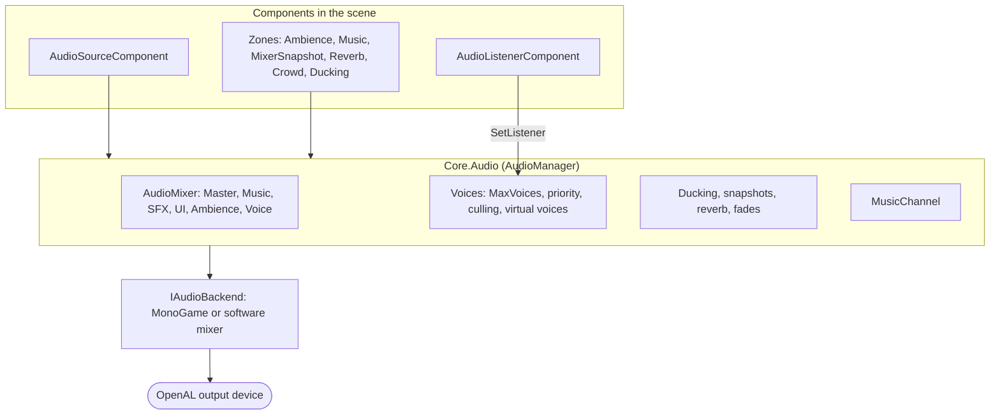

# Audio

Voltage's audio system runs through `Core.Audio`, an `AudioManager` that keeps playing across scene changes. It provides a bus mixer, 2D positional sound, trigger zones for ambience, music and mood, voice management, and an optional software mixer with low-pass and reverb. `wav`, `ogg` and `mp3` files are decoded in managed code, so audio works the same in NativeAOT builds.

## Signal path

| Stage | What happens |
|---|---|
| Sources | Components and zones start voices: one-shots, loops and positional sound. |
| Mixer | Every voice routes through a bus with volume, mute, solo, ducking and snapshots. |
| Spatial | Volume and pan follow the voice's distance and offset from the listener. |
| Voices | Priority, per-clip caps, distance culling and virtual voices keep the mix within budget. |
| Backend | MonoGame playback, or the software mixer with DSP, then the output device. |

## Audio sources

`AudioSourceComponent` plays one clip. Assign `Clip` (an asset reference) in the Inspector; with `PlayOnStart` on, it starts when Play begins. Inspector edits are heard immediately in Play mode, including while paused.

| Field or method | Purpose |
|---|---|
| `Clip`, `Bus` (default `SFX`) | What to play and which bus it routes through. |
| `Volume`, `Pitch`, `Pan`, `Muted`, `Loop` | Per-voice controls, applied every frame. |
| `RandomPitchRange` | Random pitch variation per play, for repeated sounds such as footsteps. |
| `Is3D`, `MinDistance` (100), `MaxDistance` (800) | Positional sound: full volume inside `MinDistance`, silent beyond `MaxDistance`, panned by offset. |
| `Priority` (128), `MaxInstances` | Survival order when voices run out, and a cap on overlapping copies (0 means no cap). |
| `LowPassCutoffHz`, `ReverbSend` | Per-voice DSP. Audible only with the software backend. |
| `Play()`, `Play(fadeIn)`, `Stop()` | Start or stop. |
| `FadeIn`, `FadeOut`, `FadeTo(level, s)`, `CrossfadeTo(clip, s)` | Timed volume changes and clip swaps. |

Positional sources draw their range in the editor: green for full volume, orange for silence.

## Playing from code

```csharp
using Voltage;
using Voltage.Audio;

var clip = Core.Audio.LoadClip(HitSound);                 // HitSound is an AssetReference
Core.Audio.PlaySfx(clip, bus: "SFX", volume: 0.8f);       // fire and forget

var voice = Core.Audio.PlayControlled(clip, new AudioPlaySettings
{
    Bus = "Ambience", Loop = true, Is3D = true,
    Position = Entity.Position, MinDistance = 80, MaxDistance = 600,
    Volume = 1f, Priority = 96,
});

Core.Audio.PlayMusic(Core.Audio.LoadClip(Theme), volume: 1f, fadeSeconds: 2f);
Core.Audio.StopMusic(fadeSeconds: 1.5f);
```

Music plays on its own crossfading channel; starting a new track fades out the old one.

## Zones

Zone components shape a soundscape without code. Each needs a trigger collider on the same entity, and reacts when another collider enters or leaves it. Triggers fire only for entities that move with `Mover` or `ProjectileMover` (see [Collisions](../physics/collisions.md)), so give the player a collider and move it that way. Zones ignore triggers in Edit mode.

| Component | Purpose |
|---|---|
| `AmbienceZoneComponent` | A looping bed (`Ambience`) that fades in on enter and out on exit (`FadeSeconds`). Overlapping zones blend. |
| `MusicZoneComponent` | Starts `Track` on enter, crossfading from the current music; `StopOnExit` stops it again. |
| `MixerSnapshotZoneComponent` | A mood: crossfades the Music, SFX, UI, Ambience and Voice buses to the zone's own levels on enter. Master is left alone. `RestoreOnExit` returns the previous mix. |
| `ReverbZoneComponent` | Applies `RoomSize`, `Damping` and `Wet` reverb while inside; `DisableOnExit` turns it off again. Software backend only. |
| `CrowdEmitterComponent` | Not a trigger: scatters random clips from `Clips` around the entity within `Radius`, at a rate set by `Density`, with at most `MaxConcurrent` at once. |
| `DialogueDuckingComponent` | Configures automatic ducking: while anything plays on the Voice bus, Music and Ambience dip to `DuckLevel`, then recover. |

Put `AudioListenerComponent` on whatever the player is, usually the player or the camera. It sets the listener position every frame; without one, positional sounds play at their base volume and pan.

## The mixer

```
Master
├── Music
├── SFX
├── UI
├── Ambience
└── Voice
```

| API | Purpose |
|---|---|
| `SetBusVolume(name, v)`, `GetBusVolume`, `SetBusMute`, `Bus(name)` | Per-bus gain and mute; gain multiplies down the chain to Master. Solo on any bus silences the others. |
| `Duck(bus, multiplier, recoverySeconds)` | A short sidechain dip, for example under an explosion. |
| `BeginDialogueDuck()`, `EndDialogueDuck()`, `AutoDuckDialogueEnabled` | A sustained duck while dialogue plays. `SetDialogueDuckBuses` changes which buses dip. |
| `SaveSnapshot(name)`, `TransitionTo(name, seconds)`, `CaptureSnapshot()` | Mood presets: capture bus levels and blend to them over time. Master is excluded unless you ask, so the player's volume setting is kept. |
| `PauseGameplayAudioOnPause` | Pauses the gameplay buses while Play is paused. |
| `StopAll()` | Stops every voice. |

## Voices

`MaxVoices` (default 24) caps real voices. When the pool is full, a new sound takes the weakest voice only if its priority is higher. Sounds out of range never take a voice; one-shots that would be inaudible are dropped, and distant loops become virtual (tracked but silent) and resume when back in range.

## Backends and DSP

The default backend plays each voice through MonoGame. The software backend mixes every voice into one stream, which enables per-voice low-pass (`LowPassCutoffHz`, for occlusion and distance) and a shared reverb (`ReverbSend`, `SetReverb(roomSize, damping, wet)`, `SetReverbEnabled`). It checks platform support and falls back to MonoGame when unsupported; DSP settings then do nothing.

The editor turns the software backend on. A game turns it on by setting the flag in `Program.Main`, before the game object is created:

```csharp
Voltage.Audio.AudioManager.PreferSoftwareBackend = true;
using var game = new MyGameGame();
game.Run();
```

The log shows `[Audio] Using SoftwareMixingAudioBackend` when it is active, and `Core.Audio.ReverbSupported` reports it in code.

## Mute and custom audio

The toolbar's mute button sets `Core.IsAudioOn`. While it is `false` the mixer outputs silence on every bus, and `SoundEffect.MasterVolume` is set to 0 for anything played outside the mixer. Engine audio components need nothing else.

Custom code that plays `SoundEffectInstance`s directly can react to mute by implementing `IAudioComponent` (namespace `Voltage.Utils.Audio`) and registering with `AudioComponentRegistry`:

```csharp
public partial class Engine : Component, IAudioComponent
{
    SoundEffectInstance _hum;

    public override void OnAddedToEntity() => AudioComponentRegistry.Register(this);
    public override void OnRemovedFromEntity() { AudioComponentRegistry.Unregister(this); _hum?.Dispose(); }

    public void OnAudioStateChanged(bool isAudioOn)
    {
        if (isAudioOn) _hum?.Resume(); else _hum?.Pause();
    }
}
```

## Automation

The [Editor Gateway](../gateway/README.md) exposes the mixer and zones to scripts and agents through the `audio.*` commands, for example to read the mixer state, change bus levels or create a zone.


